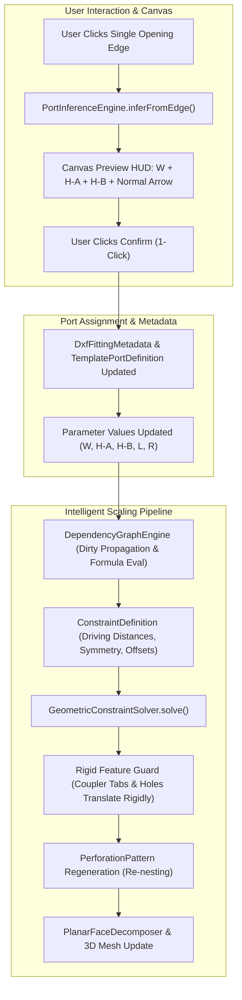

# Architectural Overhaul: Intelligent Parametric DXF Templates, Semantic Port Assignment, and Constraint-Driven Scaling

## Executive Summary
This implementation plan addresses the complete architectural overhaul of truFold Studio's drawing template system, port assignments, and drawing scaling based on the two core specifications:
1. **`truFold_Studio_Intelligent_Parametric_DXF_Template_Implementation_Guide.md`** (Architecture, Constraints, Dependency Graph, Scaling)
2. **`truFold_Studio_Port_Assignment_and_Intelligent_Scaling_UX_Guide.md`** (Semantic 1-Click Port Assignment, Dual Flange Heights H-A/H-B, Canvas Preview UX)

### The Core Paradigm Shift
- **From Direct Vertex Stretching to Constraint-Driven Geometry**: Replace the legacy bounding-box coordinate stretching in `TopologicalZoneMorpher` with a robust pipeline:
  $$\text{Parameters} \longrightarrow \text{DAG Dependency Graph} \longrightarrow \text{Geometric Constraints} \longrightarrow \text{Solver} \longrightarrow \text{Geometry}$$
- **From Multi-Click Coordinate Picking to 1-Click Semantic Port Inference**: Instead of requiring users to separately click "Select W Edge" and "Select H Edge" for each port, the user clicks **a single opening edge** on the flat pattern. The new `PortInferenceEngine` automatically determines:
  - **Width ($W$)**: Length of the selected opening boundary edge.
  - **Height A ($H_A$)**: Length of the connected sidewall/flange on Side A up to bend lines or relief notches.
  - **Height B ($H_B$)**: Length of the connected sidewall/flange on Side B (supporting asymmetric and equal sidewalls).
  - **Outward Direction / Normal Vector**: Outward unit vector indicating airflow/cable duct orientation.
  - **Coupler / Fastener Features**: Rigid punch patterns, obrounds, and tabs belonging to that port zone.
- **Rigid Feature Preservation & Pattern Regeneration**:
  - Rigid features (coupler holes, alignment slots, miter corner reliefs) translate rigidly without aspect-ratio or dimensional distortion.
  - Perforation patterns regenerate (re-nest) dynamically according to mathematical pitch and count expressions.
- **First Implementation Proof**: As mandated by the architecture guide, we prove the complete pipeline on a simple fitting (**90° Flat Bend** or **Straight Tray**) with 3-point validation before progressing to complex multi-port branches.

---

## User Review Required

> [!IMPORTANT]
> **Key Architectural Decisions Requiring User Confirmation**:
> 1. **Backward Compatibility of DSF Document & Port Schema**:
>    `TemplatePortDefinition` will be extended with optional `heightAParamKey`, `heightBParamKey`, `defaultHeightA`, `defaultHeightB`, `side`, `outwardNormalAngleRad`, and `associatedFeatureIds`. When legacy files with single `heightParamKey` are loaded, $H_A$ and $H_B$ default to the single height value ($H_A = H_B = H$).
> 2. **Preservation of Existing Infrastructure**:
>    The existing `GeometricConstraintSolver` (1388 lines), `DependencyGraphEngine`, `ExpressionParserEngine`, and `ReferenceGeometryEngine` in `lib/sheet_metal_studio/engine/constraints/` will be preserved and leveraged as the central solving pipeline. `TopologicalZoneMorpher` will be retained for baseline template generation and backward compatibility.
> 3. **Execution Sequence (Simple Before Complex)**:
>    Phase 1 will strictly prove the end-to-end flow on **90° Flat Bend** and **Straight Tray** (2 ports, rigid coupler tabs, 3-point validation). Multi-branch unequal tees and crosses will follow the established pattern in Phase 2.

---

## Current State vs Required State (Gap Analysis)

| Capability Area | Current Codebase State | Required State (Per Guides) |
|---|---|---|
| **Port Definition Model** | `TemplatePortDefinition` has only `widthParamKey` and `heightParamKey` (single height). | `TemplatePortDefinition` has `widthParamKey`, `heightAParamKey`, `heightBParamKey`, `defaultHeightA`, `defaultHeightB`, `side`, `outwardNormalAngleRad`, and `associatedFeatureIds`. |
| **Port Detection & Assignment** | Separate manual picking: user clicks "Select W Edge" then canvas, then "Select H Edge" then canvas. Heuristic mapping in `FittingPortAnnotationEngine`. | **1-Click Semantic Inference**: Clicking ONE opening edge automatically infers $W$, $H_A$, $H_B$, outward normal vector, and detects adjacent coupler features. |
| **Interactive Canvas UX** | Plain edge highlighting on hover; separate dialog pickers; no directional flow arrows or dual-flange preview. | **Canvas Preview Overlay**: Glowing opening line ($W$), distinct colored flange wings ($H_A, H_B$), outward directional arrow, and canvas HUD card `[Port 1: 300 × 50/50 mm West — Confirm ✓ / Cancel ✕]`. |
| **Drawing Scaling Engine** | `TopologicalZoneMorpher` stretches coordinates via bounding-box fraction math. Can distort hole circularity and coupler tab profiles. | **Constraint-Driven Solving**: Parameters drive DAG $\to$ constraints $\to$ `GeometricConstraintSolver`. Rigid features translate without distortion; perforation patterns re-nest via formula expressions. |
| **Per-Port Independent Heights** | Fittings assume uniform height across all ports ($H$). | Full support for unequal and asymmetric sidewalls ($H_A \neq H_B$ or Port 1 $H \neq$ Port 2 $H$). |
| **DSF 2.0 Persistence** | Stores parameters, constraints, and metadata with raw manual edge coordinates. | Persists semantic port definitions with $H_A/H_B$, outward normal, and feature IDs with full round-trip serialization. |

---

## Proposed Changes

---

### Set 0: Architectural Audit & Baseline Document
#### [NEW] [CAD_ENGINE_AUDIT.md](file:///d:/FlutterProjects/trufold_studio/docs/CAD_ENGINE_AUDIT.md)
- Complete audit report detailing:
  - Exact state and capabilities of `GeometricConstraintSolver` (52KB), `DependencyGraphEngine` (10KB), `ExpressionParserEngine` (9KB), `ReferenceGeometryEngine` (9KB), and `ContourTopologyClassifier` (8KB).
  - Integration interface between `TemplateParameterDefinition`, `DxfFittingMetadata`, and the solver.
  - Test baseline for current template morphing behavior to benchmark against constraint solving.

---

### Set 1: Port Model & Schema Extension
#### [MODIFY] [template_parameter_definition.dart](file:///d:/FlutterProjects/trufold_studio/lib/sheet_metal_studio/models/template_parameter_definition.dart)
- Extend `TemplatePortDefinition`:
  - Add `final String? heightAParamKey;`
  - Add `final String? heightBParamKey;`
  - Add `final double? defaultHeightA;`
  - Add `final double? defaultHeightB;`
  - Add `final PortSide? side;`
  - Add `final double? outwardNormalAngleRad;`
  - Add `final List<String> associatedFeatureIds;`
  - Provide backward-compatible getters: `effectiveHeightA`, `effectiveHeightB`, `isSymmetricHeight`.
  - Update `toJson()` and `fromJson()` with backward-compatible defaults.
- Update standard template presets (`cableTrayTee`, `cableTrayBend90`, `cableTrayBend45`, `cableTrayReducer`, `cableTrayCross`, `cableTrayStraight`) to define ports with dual-height keys.

#### [MODIFY] [fitting_port_annotation_engine.dart](file:///d:/FlutterProjects/trufold_studio/lib/sheet_metal_studio/engine/fitting_port_annotation_engine.dart)
- Extend `ProductPortOpening`:
  - Add `final double heightAMm;`
  - Add `final double heightBMm;`
  - Add `final CadLineSegment? edgeA;` (Sidewall A edge)
  - Add `final CadLineSegment? edgeB;` (Sidewall B edge)
  - Add `final List<String> associatedFeatureIds;`
  - Add `bool get isSymmetric => (heightAMm - heightBMm).abs() < 1e-3;`
  - Add `String get dimensionTextDual => isSymmetric ? '${widthMm.toStringAsFixed(0)} × ${heightAMm.toStringAsFixed(0)} mm' : '${widthMm.toStringAsFixed(0)} × ${heightAMm.toStringAsFixed(0)}/${heightBMm.toStringAsFixed(0)} mm';`

#### [MODIFY] [dxf_fitting_metadata.dart](file:///d:/FlutterProjects/trufold_studio/lib/sheet_metal_studio/models/dxf_fitting_metadata.dart)
- Support storage and serialization of semantic port assignments:
  - Add `Map<String, Map<String, dynamic>>? semanticPorts` storing port ID $\to$ `{width, heightA, heightB, normalAngle, side, edgeW, edgeA, edgeB, featureIds}`.
  - Maintain backward compatibility with `portAssignments` and `manualPortEdges`.

---

### Set 2: One-Click Semantic Port Inference Engine
#### [NEW] [port_inference_engine.dart](file:///d:/FlutterProjects/trufold_studio/lib/sheet_metal_studio/engine/port_inference_engine.dart)
- Implement `PortInferenceEngine` with:
  - `static PortInferenceResult inferFromOpeningEdge({required DsfDocument document, required CadPoint2D clickedPoint, CadLineSegment? candidateEdge})`:
    1. **Opening Edge Identification**: Find the closest outer contour line segment to `clickedPoint` (within pick tolerance).
    2. **Width ($W$) Calculation**: $W = \text{length}(P_1, P_2)$.
    3. **Outward Normal & Orientation**: Compute unit normal vector pointing away from the interior of the part (using winding/shoelace point-in-polygon verification). Map to `PortSide` (West, East, North, South, or Custom angle).
    4. **Sidewall Wing Detection ($H_A$ and $H_B$)**:
       - Traverse outer contour CCW from $P_1$ to detect connected transverse sidewall edge(s) up to the corner notch/bend line $\to H_A$.
       - Traverse outer contour CW from $P_2$ to detect connected transverse sidewall edge(s) up to the corner notch/bend line $\to H_B$.
    5. **Coupler & Feature Association**:
       - Search punch primitives (`CncPunchPrimitive`) and cut lines within the port zone bounding region (distance $\le \max(H_A, H_B) + 40\text{ mm}$ from opening edge).
       - Flag punch IDs as `associatedFeatureIds` (e.g. coupler mounting holes/slots).
    6. **Confidence & Validation**:
       - Ensure edge is a boundary opening, not an internal cut or flange edge.
       - Return structured `PortInferenceResult` with preview geometry, dimensions, and normal vector.
  - `static List<PortInferenceResult> autoDetectAllPorts(DsfDocument document)`: Automatic full-part port discovery for 1-click classification.

---

### Set 3: Interactive Canvas Port Assignment & Preview HUD
#### [MODIFY] [sheet_metal_studio_viewmodel.dart](file:///d:/FlutterProjects/trufold_studio/lib/sheet_metal_studio/viewmodels/sheet_metal_studio_viewmodel.dart)
- Add unified semantic port tool mode:
  - `StudioToolMode.assignPortSemantic`
  - `String? _activePortAssignId;` (e.g. `'port1'`, `'port2'`)
  - `PortInferenceResult? _stagedPortInference;`
  - `void startSemanticPortAssignment(String portId)`: activates semantic pick mode with cursor hint.
  - `void handleCanvasSemanticPortClick(CadPoint2D clickPos)`: runs `PortInferenceEngine.inferFromOpeningEdge`, stores `_stagedPortInference`, triggers canvas repaint.
  - `void confirmStagedPortAssignment()`: commits inferred $W, H_A, H_B$, normal, and feature IDs to `DxfFittingMetadata` and document parameters, closes preview HUD.
  - `void cancelStagedPortAssignment()`: clears staging and returns tool mode to select.

#### [MODIFY] [unfolded_canvas_widget.dart](file:///d:/FlutterProjects/trufold_studio/lib/sheet_metal_studio/views/widgets/unfolded_canvas_widget.dart)
- Render interactive port preview overlays:
  - **Hover Highlight**: When `assignPortSemantic` is active, hover over boundary edges highlights candidate opening in cyan.
  - **Staged Port Preview**:
    - Thick glowing line on opening edge ($W$) with label `$W\text{ mm}$`.
    - Distinct highlighted wings on Sidewall A ($H_A$) and Sidewall B ($H_B$) with dimension callouts.
    - Prominent arrow pointing outward along normal vector showing duct/fitting flow direction.
    - Highlighted circles/slots around associated coupler punches.
  - **Canvas HUD Card**:
    - Floating action card anchored near the port or top-center:
      `[ 🎯 Port 1 (Inlet): W=300 mm | H-A=50 mm | H-B=50 mm (West) ]`
      `[ ✓ Confirm ]   [ ✕ Cancel ]`

#### [MODIFY] [dxf_fitting_parameter_dialog.dart](file:///d:/FlutterProjects/trufold_studio/lib/sheet_metal_studio/views/widgets/dxf_fitting_parameter_dialog.dart)
- Upgrade Port Cards to support:
  - Unified **"Auto-Detect from Opening Edge 🎯"** button per port (replaces the cumbersome separate W/H buttons while keeping them as manual fallbacks).
  - Dual-height display: $W$, $H_A$, $H_B$ with "Link / Sync $H_A=H_B$" lock icon.
  - Visual status pill indicating whether the port was auto-inferred, manually picked, or default.

---

### Set 4: Constraint-Driven Scaling Pipeline & Rigid Feature Protection
#### [MODIFY] [geometric_constraint_solver.dart](file:///d:/FlutterProjects/trufold_studio/lib/sheet_metal_studio/engine/constraints/geometric_constraint_solver.dart)
- Enhance rigid feature group handling:
  - Identify punch groups tagged in `associatedFeatureIds` or within coupler zones.
  - Ensure solver moves rigid punch groups as rigid clusters via reference vector translation (distance to opening edge and centerline maintained without altering punch spacing, diameter, or slot dimensions).
- Add support for dual-height sidewall driving constraints ($H_A$ and $H_B$ drive the left and right flange offsets independently).
- Re-nest perforation patterns using `DependencyGraphEngine.evaluatePattern` to recompute hole rows/columns without stretching hole geometries.

#### [MODIFY] [sheet_metal_studio_viewmodel.dart](file:///d:/FlutterProjects/trufold_studio/lib/sheet_metal_studio/viewmodels/sheet_metal_studio_viewmodel.dart)
- Connect template parameter updates directly to the constraint solver:
  - In `updateTemplateParameter(key, value)`:
    1. Mark parameter dirty in `_dependencyGraph`.
    2. Evaluate any dependent formulas via `ExpressionParserEngine`.
    3. Invoke `GeometricConstraintSolver.solve(...)` with driving constraints synthesized from template port definitions.
    4. Regenerate perforation patterns and recompute 3D unfold mesh.
    5. Maintain `TopologicalZoneMorpher` as fallback for non-constrained arbitrary contours.

---

### Set 5: First Simple Template End-to-End Proof (90° Flat Bend & Straight Tray)
#### [MODIFY] [template_parameter_definition.dart](file:///d:/FlutterProjects/trufold_studio/lib/sheet_metal_studio/models/template_parameter_definition.dart)
- Refine baseline definitions for:
  - **`cableTrayBend90`**: 2 ports (Inlet, Outlet), parameters: `width`, `heightA`, `heightB`, `radius`, `angle`. Rigid coupler hole clusters at Port 1 and Port 2.
  - **`cableTrayStraight`**: 2 ports (Inlet, Outlet), parameters: `width`, `heightA`, `heightB`, `length`. Rigid coupler tabs at ends, perforated floor pattern in center.
- Implement 3-Point Parameter Validation for both:
  - Test 1: **Nominal** ($W=300, H=50, L=1000 / R=100$)
  - Test 2: **Minimum** ($W=100, H=25, L=200 / R=50$)
  - Test 3: **Maximum** ($W=600, H=100, L=3000 / R=300$)
  - Verify positive edge lengths, intact hole geometries, non-collapsing miter reliefs.

---

## Verification Plan

### Automated Unit & Engine Tests
Run via powershell: `flutter test test/sheet_metal_studio/`

1. **`test/sheet_metal_studio/port_inference_engine_test.dart`** [NEW]:
   - Test opening edge detection on straight tray and 90° bend contours.
   - Test outward normal calculation for West, East, North, South openings.
   - Test dual-height sidewall detection ($H_A$ and $H_B$) for equal and unequal flanges.
   - Test associated coupler feature identification.
2. **`test/sheet_metal_studio/geometric_constraint_solver_test.dart`** [EXPAND]:
   - Test scaling of 90° bend from $W=300$ to $W=600$: verify punch diameter remains invariant.
   - Test dual-height constraints ($H_A=50, H_B=75$): verify respective flange lines translate correctly.
3. **`test/sheet_metal_studio/template_scaling_test.dart`** [NEW]:
   - Execute 3-Point validation suite on Straight Tray and 90° Flat Bend.
   - Verify closed outer contour integrity (no self-intersections, no collapsed segments).
4. **`test/sheet_metal_studio/dsf_document_roundtrip_test.dart`** [EXPAND]:
   - Verify serialization and deserialization of upgraded `TemplatePortDefinition` and semantic port metadata.

### Manual Verification in Studio UI
1. **Import DXF**: Import a standard 90° flat bend or straight cable tray DXF.
2. **1-Click Port Assignment**:
   - Open DSF Fitting Inspector.
   - Click "Auto-Detect from Opening Edge 🎯" on Port 1.
   - Click the west opening edge on the canvas.
   - Verify canvas preview shows: cyan opening line, amber sidewall wings ($H_A, H_B$), outward flow arrow, and HUD card.
   - Click "Confirm". Verify Port 1 is assigned with exact measured width and height.
   - Repeat for Port 2 (outlet).
3. **Parametric Scaling**:
   - Change Width from $300\text{ mm}$ to $500\text{ mm}$.
   - Verify outer contour widens smoothly.
   - Verify coupler holes translate along the port opening without stretching or ovalization.
   - Verify bend line lengths and positions update correctly.
4. **3D Fold Verification**:
   - Drag fold slider to 100% or click "Auto Fold".
   - Verify 3D channel renders with crisp vertical sidewalls of height $H_A$ and $H_B$.
