# Implementation Plan — Onshape-Grade Sketch Geometric & Dimensional Constraints

Transform truFold Studio's 2D canvas into a functional CAD sketch constraint environment matching PTC Onshape's training workflow ([YouTube: 6STIrs0U8y4](https://www.youtube.com/watch?v=6STIrs0U8y4)):
1. **Interactive Sketch Dimension Tool (`DimensionTool`, shortcut `D`)**: 1-click edge or 2-click point selection $\to$ mouse leader line pull-out $\to$ click to drop $\to$ instant inline value input $\to$ real-time solver update.
2. **Interactive Canvas Constraint Micro-Glyphs (`H`, `V`, `//`, `⊥`, `◎`, `⇋`, `=`, `•`, `🔒`)**: direct canvas badges, hover cross-highlighting of linked geometry, and 1-click / Delete-key removal.
3. **Floating Contextual Constraint Quick Bar**: floating pill toolbar when 1 or 2 entities are selected offering valid geometric constraints.
4. **Degrees of Freedom (DOF) Visual Diagnostics**: color-coded geometry (CAD Blue = under-constrained, Slate Black = fully constrained, Crimson Red = over-constrained/conflict).

---

## User Review Required

> [!IMPORTANT]
> **Key UX & Architectural Decisions**:
> 1. **Inline Dimension Input**:
>    When placing a dimension with the Dimension Tool, dropping the leader line immediately displays a sleek inline text box on top of the dimension badge (pre-filled with the current measured value). Pressing **Enter** commits and drives the geometry; pressing **Esc** cancels.
> 2. **Hover Cross-Highlighting**:
>    Hovering over any constraint glyph on the canvas (e.g. `//` Parallel) immediately illuminates all participating entities (e.g. Cut Line 1 and Bend Line 2) with a distinctive cyan/yellow glow, making design intent instantly readable.
> 3. **Sheet Metal Punch Invariance**:
>    Geometric and dimensional constraint solving will continue to respect rigid sheet metal punch tools ($7\times 30\text{ mm}$ slots, round holes, flange notches) so they translate and align without distortion or ovalization.

---

## Proposed Changes

```mermaid
flowchart TD
    subgraph Dimension_Tool["Interactive Dimension Tool ('D')"]
        Pick["Pick 1 Edge or 2 Points"] --> DragLeader["Mouse Pulls Out Extension & Dimension Line"]
        DragLeader --> Drop["Click to Drop Dimension Line"]
        Drop --> InlineInput["Inline Floating Value Card (Auto-focused)"]
        InlineInput --> DriveSolver["DirectDimensionDriver / GeometricConstraintSolver"]
    end

    subgraph Constraint_Glyphs["Interactive Canvas Constraint Glyphs"]
        RenderGlyphs["CanvasConstraintPainter"] --> HitTest["_constraintBadgeRects Hit-Testing"]
        HitTest --> Hover["Hover Glyph: Halo Highlight on Linked Geometry"]
        HitTest --> Select["Click Glyph: Select & Show ✕ Delete / Press Del"]
    end

    subgraph Quick_Toolbar["Floating Contextual Constraint Bar"]
        SelectEntities["Select 1 or 2 Entities on Canvas"] --> ContextRules["Evaluate Valid Constraints (H, V, //, ⊥, =, •, ◎, 🔒)"]
        ContextRules --> PillBar["Display Floating Pill Bar Near Cursor"]
        PillBar --> Apply["1-Click Apply: Add Constraint & Solve"]
    end

    subgraph DOF_Diagnostics["Degrees of Freedom Diagnostics"]
        PaletteToggle["Sketch Palette Toggle: DOF Colors"] --> EvalDOF["Classify Entity DOF (Solver & Fixed Rules)"]
        EvalDOF --> Blue["Blue (#0284C7): Under-Constrained"]
        EvalDOF --> Black["Black (#0F172A): Fully Constrained"]
        EvalDOF --> Red["Red (#EF4444): Over-Constrained / Conflict"]
    end
```

---

### Component 1: Smart Interactive Sketch Dimension Tool
#### [MODIFY] [sheet_metal_studio_viewmodel.dart](file:///d:/FlutterProjects/trufold_studio/lib/sheet_metal_studio/viewmodels/sheet_metal_studio_viewmodel.dart)
- Extend `StudioToolMode.addDimension` handling:
  - Support single edge/line pick: when clicking an edge, detect line endpoints (`p1, p2`), calculate current length, and enter dimension leader drag mode (`_activeDimensionDrag`).
  - Support 2-point pick: if clicking endpoints or punch centers, transition from point 1 to point 2, then enter leader drag mode.
  - Track `_pendingDimensionLeaderOffset` during mouse move so leader lines and witness lines follow the cursor.
  - Add `commitDimensionWithOffset({required CadPoint2D pA, required CadPoint2D pB, required double offset, double? drivingValue})`.

#### [MODIFY] [unfolded_canvas_widget.dart](file:///d:/FlutterProjects/trufold_studio/lib/sheet_metal_studio/views/widgets/unfolded_canvas_widget.dart)
- Add interactive leader line pull-out rendering in `_UnfoldedCanvasPainter`:
  - When in dimension placement drag, draw dynamic witness extension lines and dimension line with arrowheads following mouse offset.
- Add **Inline Floating Dimension Callout Widget**:
  - Positioned directly over the newly placed dimension badge.
  - `TextField` with auto-focus, selecting current text.
  - Hitting `Enter` applies new dimension via `viewModel.driveDimension(...)` and solves geometry.
  - Hitting `Esc` or clicking away dismisses the callout.
- Add Keyboard Shortcut:
  - Pressing `D` activates `viewModel.setToolMode(StudioToolMode.addDimension)`.

---

### Component 2: Interactive Canvas Constraint Micro-Glyphs
#### [MODIFY] [canvas_constraint_painter.dart](file:///d:/FlutterProjects/trufold_studio/lib/sheet_metal_studio/views/widgets/canvas/canvas_constraint_painter.dart)
- Update `CanvasConstraintPainter.paint`:
  - Accept optional `Map<String, Rect>? renderedConstraintBadges` to collect rendered screen rects for hit-testing.
  - Support `hoveredConstraintId`: render hovered glyph with an elevated cyan border (`#06B6D4`) and subtle drop shadow.
  - Render a small `✕` delete button inside the badge when selected or hovered.

#### [MODIFY] [unfolded_canvas_widget.dart](file:///d:/FlutterProjects/trufold_studio/lib/sheet_metal_studio/views/widgets/unfolded_canvas_widget.dart)
- Add `_constraintBadgeRects = <String, Rect>{}`.
- In `onHover`:
  - Hit-test `_constraintBadgeRects`. If cursor is over a constraint glyph, set `_hoveredConstraintId`.
  - Look up constraint references and populate `_highlightedEntityIds` so participating lines/points glow on the canvas.
- In `onPanStart` / `onTapUp`:
  - If user clicks on a constraint glyph:
    - Select it: `viewModel.selectConstraint(constraintId)`.
    - If user clicks the `✕` region or presses `Delete` / `Backspace`, remove constraint: `viewModel.removeConstraint(constraintId)` and re-solve.

---

### Component 3: Floating Sketch Constraint Quick Bar
#### [NEW] [floating_sketch_constraint_bar.dart](file:///d:/FlutterProjects/trufold_studio/lib/sheet_metal_studio/views/widgets/canvas/floating_sketch_constraint_bar.dart)
- Build a lightweight, floating glassmorphic pill bar:
  - Displays context-sensitive constraint icons with tooltips and shortcuts:
    - **1 Line**: `H` (Horizontal), `V` (Vertical), `🔒` (Fix).
    - **2 Lines**: `//` (Parallel), `⊥` (Perpendicular), `=` (Equal Length), `⎻` (Collinear).
    - **2 Points**: `•` (Coincident), `H` (Horizontal Align), `V` (Vertical Align).
    - **1 Point + 1 Line**: `⇋` (Midpoint), `•` (Coincident to line).
    - **2 Punches / Circles**: `◎` (Concentric), `=` (Equal Diameter).
  - Tapping an icon instantly applies the constraint via `viewModel.applyConstraint(...)` and re-solves.
- Render in `unfolded_canvas_widget.dart` floating adjacent to the current selection or top-center of the canvas.

---

### Component 4: Degrees of Freedom (DOF) Visual Diagnostics
#### [MODIFY] [sheet_metal_studio_viewmodel.dart](file:///d:/FlutterProjects/trufold_studio/lib/sheet_metal_studio/viewmodels/sheet_metal_studio_viewmodel.dart)
- Add `bool _showDofDiagnostics = false;` (with getter and `toggleDofDiagnostics()`).
- Add helper `EntityConstraintState getEntityConstraintState(String entityId)`:
  - Returns `EntityConstraintState.overConstrained` if entity participates in a conflicted constraint (`currentSolverConflicts.isNotEmpty`).
  - Returns `EntityConstraintState.fullyConstrained` if entity is fixed or has both position and size constrained.
  - Returns `EntityConstraintState.underConstrained` if degrees of freedom remain.

#### [MODIFY] [studio_sketch_palette.dart](file:///d:/FlutterProjects/trufold_studio/lib/sheet_metal_studio/views/widgets/studio/studio_sketch_palette.dart)
- Add checkbox: `Degrees of Freedom Colors (Blue/Black/Red)` bound to `viewModel.showDofDiagnostics`.

#### [MODIFY] [unfolded_canvas_widget.dart](file:///d:/FlutterProjects/trufold_studio/lib/sheet_metal_studio/views/widgets/unfolded_canvas_widget.dart)
- In `_UnfoldedCanvasPainter`:
  - When `showDofDiagnostics` is active, stroke cut lines, contour segments, and punches using:
    - **CAD Blue (`#0284C7`)** for under-constrained.
    - **Slate Black (`#0F172A`)** for fully constrained.
    - **Crimson Red (`#EF4444`)** for over-constrained/conflict.

---

## Verification Plan

### Automated Tests
1. **New Unit & Interaction Tests**:
   - Create `test/modules/sheet_metal_studio/sketch_constraints_interaction_test.dart`:
     - Test 1: Single-click line selection in dimension tool creates dimension with line's exact length.
     - Test 2: Driving dimension modification via `DirectDimensionDriver` changes geometry in document.
     - Test 3: Contextual constraint application (`applyConstraint` for Horizontal, Vertical, Parallel, Perpendicular, Equal, Coincident).
     - Test 4: Constraint glyph hit-testing and removal updates document and clears conflicts.
     - Test 5: DOF diagnostic classifier correctly assigns Under-constrained (Blue), Fully-constrained (Black), and Conflict (Red).
2. **Regression Test Suite**:
   - Run `flutter test test/modules/sheet_metal_studio` (all existing 153 tests must continue to pass).
   - Run `flutter analyze lib/sheet_metal_studio test/modules/sheet_metal_studio` (0 issues).

### Manual Verification
- Launch canvas, press `D`, click an edge, drag leader line, click to drop, type `250` into the inline input card, hit Enter, observe geometry scaling.
- Select two lines, click `// Parallel` in the floating constraint bar, observe `//` glyph appear on canvas.
- Hover over `//` glyph, verify both lines highlight with cyan glow. Click glyph and press Delete, verify glyph disappears.
- Enable `Degrees of Freedom Colors` in Sketch Palette, verify free lines show in CAD Blue and fixed/dimensioned lines show in Slate Black.
