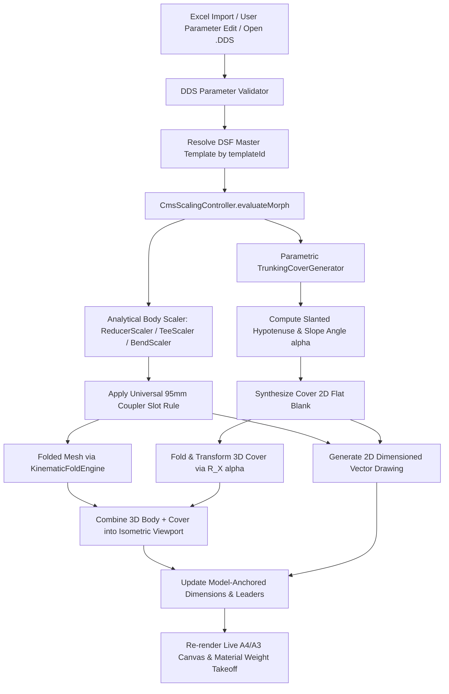

# TruFold Studio — DDS Technical Data Sheet (TDS) System
## End-to-End User Experience, Document Architecture, UI Walkthrough & Implementation Blueprint

---

## Executive Summary

The **Technical Data Sheet (TDS)** system is the next major evolutionary leap for TruFold Studio. It elevates TruFold Studio from an intelligent sheet-metal design and parametric scaling tool into a **complete product documentation, order-processing, and client-approval submittal platform**.

The system introduces the native `.dds` (**D**ata **D**ocument / **D**ata **S**heet) file format. A `.dds` file is a self-contained, multi-sheet engineering document that:
1. **References TruFold's built-in CMS `.dsf` templates** (which remain the immutable geometry and folding authority).
2. **Supports 1-click batch import of Customer Order Schedules from Excel (`.xlsx`)**, automatically generating complete submittal packages with matched templates and order metadata.
3. **Decouples Engineering Product Instances from Presentation Sheets**, enabling true multi-sheet binders, product duplication, and traceability.
4. **Captures live-generated covers**, intelligent technical dimensions, and engineering annotations.
5. **Presents publication-grade 2D orthographic drawings and 3D isometric technical sheets** formatted for formal client submittals and approvals.

---

## 1. Core Architectural Principles

```text
┌────────────────────────────────────────────────────────────────────────┐
│                      THE FUNDAMENTAL SEPARATION                        │
├───────────────────────────────────┬────────────────────────────────────┤
│   DSF Template (Master Library)   │     DDS Document (User Instance)   │
├───────────────────────────────────┼────────────────────────────────────┤
│ • Immutable CAD base geometry     │ • Stores user-edited dimensions    │
│ • Mathematical bend kinematics    │ • Stores customer order metadata   │
│ • Coupler flap & slot definitions │ • Stores cover options & depths    │
│ • Flange rules & port topologies  │ • Stores notes & annotations       │
│ • Parametric scaling logic        │ • Stores title block & revisions   │
│ • Lives permanently inside app    │ • References template by ID & ver  │
│                                   │ • Lives as portable project file   │
└───────────────────────────────────┴────────────────────────────────────┘
```

> **The Cardinal Rules:**  
> 1. **DSF is the immutable base definition.** Editing a parameter inside a `.dds` document **never** alters the underlying `.dsf` template file on disk.
> 2. **DDS stores the instance parameter state.** When a `.dds` document is opened, TruFold Studio resolves the referenced template from its internal library, applies the stored instance parameters through the analytical CMS scaling engine, synthesizes the parametric cover, and reconstructs the live 2D and 3D geometry in real time.
> 3. **Excel is an import source, not a live runtime dependency.** The `.dds` file captures all imported parameters, quantities, and order lines so the document functions autonomously even if the original spreadsheet is moved, renamed, or deleted.
> 4. **Product Instances are distinct from Presentation Sheets.** The underlying engineering product instance holds the validated sizing and metadata; sheets present views, drawings, and annotations of that instance.

---

## 2. End-to-End User Journey Walkthrough

The user can initiate a Technical Data Sheet via two powerful workflows:
- **Workflow A:** Automated Creation from an Excel Customer Order List (`.xlsx`).
- **Workflow B:** Manual Assembly from the CMS Template Library.

```text
       ┌───────────────────────────────┐
       │   New Technical Data Sheet    │
       └───────────────┬───────────────┘
                       │
         ┌─────────────┴─────────────┐
         ▼                           ▼
[ Workflow A: Excel Import ]   [ Workflow B: Manual Assembly ]
         │                           │
Select .xlsx Order List        Pick Templates from Gallery
Map Columns (Item, W, H, Qty)  Configure Initial Parameters
Batch Template Resolution      Add Sheets to Binder
         │                           │
         └─────────────┬─────────────┘
                       ▼
       ┌───────────────────────────────┐
       │     DDS Authoring Canvas      │
       │  • Edit Table Dimensions      │
       │  • Live 2D & 3D Regeneration  │
       │  • Add Dynamic Annotations    │
       │  • Complete Approval Block    │
       └───────────────┬───────────────┘
                       │
         ┌─────────────┴─────────────┐
         ▼                           ▼
   Save .dds File             Export PDF Submittal
```

---

### Workflow A: 1-Click Excel Order Import (`.xlsx`)

1. **Selecting the Customer Order File:**
   - The user clicks **"Create from Excel / Import Order List"**.
   - A file picker allows selecting any standard Excel workbook (`.xlsx`).
   - If the workbook has multiple tabs, a dropdown lets the user pick the target worksheet (e.g. *Sheet 1*, *Cable Trunking Schedule*, *BoQ Line Items*).

2. **Worksheet Row Preview & Column Mapping:**
   - TruFold inspects the header row and displays an intuitive **Column Mapping Dialog**:
   
   | Spreadsheet Column Header | Detected Sample Value | TruFold DDS Target Field | Mapping Status |
   |---|---|---|:---:|
   | `Item No.` | `01` | `orderLine` | Matched |
   | `Tag / Ref` | `TR-TEE-01` | `customerItemReference` | Matched |
   | `Description` | `Equal Tee 100x100 with Cover` | `customerDescription` | Matched |
   | `Fitting Type` | `Equal Tee` | `templateLookup` | Matched |
   | `Width (W1)` | `100` | `port1_width` | Matched |
   | `Height (H1)` | `100` | `port1_height` | Matched |
   | `Length` | `150` | `length` | Matched |
   | `Sheet Gauge` | `1.5mm` | `sheet_thickness` | Matched |
   | `Order Qty` | `25` | `quantity` | Matched |
   | `Notes` | `Level 2 Risers` | `lineItemRemarks` | Matched |

   - The mapping interface allows users to reassign any dropdown if column names differ across clients. Mappings are remembered for future imports.

3. **Intelligent Template Matching & Resolution:**
   - The importer resolves each line against TruFold's CMS template library using:
     1. Exact Product / Template Code.
     2. Recognized Product Type keyword parsing (`equal tee`, `90 deg bend`, `reducer`, `inside riser`).
     3. User-assisted selection for ambiguous rows.
   - TruFold displays an **Import Summary Modal**:
     ```text
     ✓ 24 Order Lines Detected
     ✓ 22 Templates Matched Automatically
     ⚠  2 Lines Require Template Confirmation:
        • Line 14: "Transition Trunking" → [Select: Straight Reducer ▼]
        • Line 19: "Special Gusset"     → [Select: 45° Flat Bend   ▼]
     [ Review & Create DDS ]
     ```

4. **Instant Submittal Assembly:**
   - Clicking **"Create DDS"** generates the complete project document:
     - **Sheet 01:** Auto-populated **Order / Product Schedule** listing all items, quantities, tags, and status.
     - **Sheets 02 to 25:** Dedicated technical data sheets for every unique fitting, pre-scaled to the customer's exact dimensions, with parametric covers enabled and 3D models folded!

---

### Workflow B: Manual Technical Data Sheet Authoring

1. **Initiating Document Control:**
   - User clicks **"New Technical Data Sheet"** $\to$ fills project metadata:
     - **Project:** *Metro Line 3 — Underground Stations MEP*
     - **Client:** *National Transport Authority*
     - **Consultant:** *Atkins Global / WSP Joint Venture*
     - **Contractor:** *Al-Farooq Electromechanical Contracting*
     - **Document Number:** *TFS-TDS-ELEC-TR-004* | **Rev:** `00` | **Status:** `FOR APPROVAL`
     - **Sheet Standard:** `ISO A4 Landscape (297 x 210 mm)` or `ISO A3 Landscape`.

2. **Adding Product Sheets to the Binder:**
   - In the **Sheet Navigator**, user clicks **"+ Add Product Sheet"**.
   - Selects **"Straight Reducer"** from the gallery.
   - TruFold resolves `reducer_100x100x50x50.dsf`, creates the instance, folds it in 3D, and renders the live orthographic 2D drawing and 3D isometric model.

3. **Interactive Sizing via the Tabular Parameter Window:**
   - The user opens the **Parameter Table** dock:
     - `Port 1 Width (Inlet)`: Change from `100.0` to `150.0 mm`.
     - `Port 1 Height (Inlet)`: `100.0 mm`.
     - `Port 2 Width (Outlet)`: Change from `50.0` to `75.0 mm`.
     - `Port 2 Height (Outlet)`: `50.0 mm`.
     - `Fitting Length`: `150.0 mm`.
     - `Sheet Thickness`: `1.50 mm (16 Gauge)`.
     - `Material / Finish`: `Pre-Galvanized Steel DX51D + Z275 (BS EN 10346)`.
   - **Real-Time Live Evaluation:**
     - The analytical [`ReducerScaler`](file:///d:/FlutterProjects/trufold_studio/lib/sheet_metal_studio/engine/cms/reducer_scaler.dart) calculates the new cheek angles and notch boundaries.
     - The universal 95mm slot rule recalculates coupler slot counts automatically.
     - The parametric [`TrunkingCoverGenerator`](file:///d:/FlutterProjects/trufold_studio/lib/sheet_metal_studio/engine/covers/trunking_cover_generator.dart) recalculates the true slanted hypotenuse length $L_{\text{slanted}} = \sqrt{150^2 + (100 - 50)^2} = 158.11\,\text{mm}$ and pitches the 3D cover to $\alpha = 18.43^\circ$.
     - Both 2D technical drawings and 3D isometric viewports update **synchronously and live** on the paper canvas.

4. **Configuring the Parametric Cover:**
   - `Include Cover: [X] Yes`
   - `Flange Depth`: `12.0 mm` (Adjustable between 8.0mm and 25.0mm).
   - `Placement Mode 3D`:
     - *Installed (Snapped to Base):* Complete assembled fitting with cover resting cleanly on top of side return flanges with 5mm elevation clearance.
     - *Exploded / Lifted (+Z):* Hovers the cover 40mm above the fitting along its normal axis to display internal wiring room and return flanges.
     - *Side-by-Side (2D & 3D):* Places the cover beside the body for manufacturing clarity.

5. **Applying Technical Annotations & Callouts:**
   - **Dimension Tool:** Clicks Port 1 mouth $\to$ draws dimension line displaying `W1 = 150.0 mm`.
   - **Intelligent Parameter Binding:** If the user later edits the table from 150mm to 200mm, the printed dimension label automatically updates to `W1 = 200.0 mm`!
   - **Leader Note Tool:** Points arrow to coupler flap $\to$ adds note: *"4x Ø6.0mm earth continuity holes & slots for M6 roofing bolts"*.
   - **Revision Cloud:** Highlights customized dimensions if site-specific variations apply.

6. **Title Block & Client Approval Stamp Block:**
   - The sheet features an international standard **ISO 7200 Title Block** and a **Formal Review Block**:
     `[ ] A - Approved Without Comments`  
     `[ ] B - Approved As Noted`  
     `[ ] C - Revise and Resubmit`  
     `Reviewed By: ___________________ Date: _________`

7. **Save `.dds` and Export Client PDF Submittal:**
   - Save native `.dds` file (<100 KB compact vector format).
   - Export publication-grade vector PDF (sharp at 1200 DPI plotting, multi-page booklet ready for client submission).

---

## 3. Data Architecture: The `.dds` File Format Schema

The `.dds` file format is a structured, UTF-8 JSON document package. Notice the clear architectural separation between **`productInstances`** (engineering parameters) and **`sheets`** (presentation views):

```json
{
  "ddsHeader": {
    "format": "TruFold_DDS",
    "version": 1,
    "generator": "TruFold Studio 2.0",
    "createdAt": "2026-09-26T21:30:00Z",
    "modifiedAt": "2026-09-26T21:45:00Z"
  },
  "projectInfo": {
    "documentTitle": "Cable Trunking Fittings Technical Submittal",
    "documentNumber": "TFS-TDS-TR-2026-001",
    "revision": "01",
    "status": "For Approval",
    "projectName": "Metro Station Complex — Package 3",
    "client": "National Transit Authority",
    "consultant": "Apex Engineering Consultants",
    "contractor": "Delta MEP Contracting LLC",
    "preparedBy": "A. Lead Engineer",
    "checkedBy": "D. Quality Manager",
    "approvedBy": "M. Technical Director",
    "issueDate": "2026-09-26",
    "orderInfo": {
      "orderNumber": "PO-88492-METRO",
      "orderDate": "2026-09-20",
      "sourceType": "excel",
      "sourceFileName": "Customer_Order_Schedule_Rev2.xlsx",
      "totalOrderQuantity": 142
    },
    "generalNotes": [
      "All trunking and fittings manufactured in strict accordance with BS EN 50085-1.",
      "Material: Hot-dip continuously pre-galvanized mild steel to BS EN 10346 Grade DX51D + Z275.",
      "All dimensions are nominal internal duct dimensions in millimeters unless noted otherwise.",
      "Integral coupler flaps feature pre-punched holes/slots to accept standard M6x12mm fasteners."
    ]
  },
  "productInstances": [
    {
      "instanceId": "prod_inst_001",
      "productName": "Straight Concentric Reducer",
      "productCode": "TR-RED-150x100-75x50",
      "orderLine": {
        "orderNumber": "PO-88492-METRO",
        "lineNumber": "001",
        "customerItemReference": "TR-001",
        "quantity": 12,
        "customerDescription": "Reducer 150x100 to 75x50 Pre-Galv",
        "remarks": "Main gallery intake transition"
      },
      "templateReference": {
        "templateId": "trunking_reducer",
        "templateCategory": "trunking_accessories",
        "baselineFileName": "reducer_100x100x50x50.dsf",
        "templateFingerprint": "sha256_e4b8a1c90..."
      },
      "instanceParameters": {
        "port1_width": 150.0,
        "port1_height": 100.0,
        "port2_width": 75.0,
        "port2_height": 50.0,
        "length": 150.0,
        "sheet_thickness": 1.5,
        "material": "Pre-Galvanized Steel DX51D+Z275",
        "finish": "Natural Mill Galvanized (Z275)"
      },
      "coverConfiguration": {
        "included": true,
        "flangeDepthMm": 12.0,
        "placementMode3D": "snappedToBase",
        "clearanceOffsetMm": 2.0,
        "snappedElevationZ": 5.0,
        "customOffset3D": { "x": 0.0, "y": 0.0, "z": 0.0 }
      },
      "calculatedTakeoff": {
        "blankSurfaceAreaM2": 0.188,
        "estimatedNetWeightKg": 1.48
      }
    }
  ],
  "sheets": [
    {
      "sheetId": "sheet_cover_001",
      "sheetType": "coverSchedule",
      "sheetNumber": 1,
      "title": "Submittal Transmittal & Product Schedule",
      "tableOfContents": [
        {
          "sheetNumber": 2,
          "orderLine": "001",
          "customerRef": "TR-001",
          "productName": "Straight Reducer 150x100 to 75x50",
          "configuration": "W1=150 H1=100 W2=75 H2=50",
          "quantity": 12,
          "status": "Resolved"
        }
      ]
    },
    {
      "sheetId": "sheet_prod_002",
      "sheetType": "productSheet",
      "sheetNumber": 2,
      "productInstanceId": "prod_inst_001",
      "annotations": [
        {
          "id": "ann_dim_p1_w",
          "space": "model",
          "type": "linearDimension",
          "anchorEntity": "PORT_1_WIDTH",
          "p1": { "x": 98.58, "y": 26.62 },
          "p2": { "x": 248.58, "y": 26.62 },
          "prefix": "W1 = ",
          "suffix": " mm"
        },
        {
          "id": "ann_leader_coupler",
          "space": "model",
          "type": "leaderNote",
          "targetPoint": { "x": 105.0, "y": 15.0 },
          "textPosition": { "x": 60.0, "y": -10.0 },
          "text": "Integral Coupler Flap (4x M6 Slots)"
        },
        {
          "id": "ann_sheet_note_01",
          "space": "sheet",
          "type": "noteBox",
          "boxRect": { "x": 20.0, "y": 140.0, "width": 80.0, "height": 30.0 },
          "text": "NOTE: Outlet Port 2 connects directly to 75x50 horizontal branch run."
        }
      ],
      "viewSettings": {
        "paperSize": "A4_Landscape",
        "splitRatio2D3D": 0.50,
        "camera3D": { "elevationDeg": 30.0, "azimuthDeg": 45.0, "zoom": 1.25 },
        "drawing2D": { "viewMode": "dimensionedOutline", "showBendLines": true }
      }
    }
  ]
}
```

---

## 4. UI Layout Architecture: The Technical Data Sheet Workspace

TruFold Studio incorporates a top-level workspace switcher:
`[ 2D CAD Canvas ]  [ 3D Fold View ]  [ Technical Data Sheet (TDS) ]`

```text
+---------------------------------------------------------------------------------------------------+
| TRUFOLD STUDIO 2.0  [File] [Edit] [Excel Import] [View] [Tools] [Export PDF]     User: Eng. Dan   |
| Active Workspace: ( ) 2D CAD Canvas    ( ) 3D Fold View    (*) Technical Data Sheet (TDS)         |
+-------------------+-------------------------------------------------------------------------------+
| SHEET NAVIGATOR   | LIVE PAPER SHEET CANVAS (A4 Landscape 297 x 210 mm)               [100% Zoom] |
|                   | +---------------------------------------------------------------------------+ |
| [Import Excel...] | | [LOGO]  TRUFOLD TRUNKING TECHNICAL DATA SHEET       DOC: TFS-TDS-001      | |
| [ + Add Product ] | | Product: Straight Reducer 150x100 to 75x50          Rev: 01 (FOR APPROVAL)| |
|                   | |-------------------------------------+-------------------------------------| |
| 01. Cover & BoQ   | | 2D TECHNICAL PLAN VIEW              | 3D ASSEMBLED ISOMETRIC VIEW         | |
| > 02. Reducer     | |                                     |                                     | |
| 03. Equal Tee     | |        W1=150.0mm                   |            /============/           | |
| 04. 90° Bend      | |    +-----------------+              |           / Cover      /            | |
|                   | |    \                 /              |          /============/             | |
| [Duplicate Sheet] | |     \               /               |         / Slanted    /              | |
| [Delete Sheet]    | |      \  (Hole Ø6)  /                |        / 18.4°      /               | |
| [Move Up/Down]    | |       +-----------+                 |       +------------+                | |
|                   | |         W2=75.0mm                   |       | Body Base  |                | |
|-------------------| |-------------------------------------+-------------------------------------| |
| ANNOTATION PALETTE| | SPECIFICATION & PARAMETERS          | GENERAL NOTES & APPROVALS           | |
|                   | | Port 1: 150 x 100 mm  (Inlet)       | • Conforms to BS EN 50085-1         | |
| [Arrow Dimension] | | Port 2:  75 x  50 mm  (Outlet)      | • Pre-Galv. Steel 1.5mm (Z275)      | |
| [Leader Note]     | | Length: 150 mm | Cover: Yes (12mm)  | • Approved without comments [ ]     | |
| [Text Box]        | | Net Weight: ~1.48 kg | Order Qty: 12| • Approved as noted         [ ]     | |
| [Revision Cloud]  | | Prepared: Dan | Date: 2026-09-26    | Signed: ___________________________ | |
| [Approval Stamp]  | +---------------------------------------------------------------------------+ |
|-------------------+-------------------------------------------------------------------------------+
| PARAMETER TABLE (Active Instance: prod_inst_001 — Straight Reducer)                               |
| Parameter Name        | Value     | Unit | Source        | Status / Validation                    |
|-----------------------+-----------+------+---------------+----------------------------------------|
| Port 1 Width (Inlet)  | 150.0     | mm   | DDS Instance  | [  50.0 — 600.0 mm ] (Overridden)      |
| Port 1 Height (Inlet) | 100.0     | mm   | DDS Instance  | [  50.0 — 300.0 mm ] (Template Def)    |
| Port 2 Width (Outlet) | 75.0      | mm   | DDS Instance  | [  50.0 — 600.0 mm ] (Overridden)      |
| Port 2 Height (Outlet)| 50.0      | mm   | DDS Instance  | [  50.0 — 300.0 mm ] (Template Def)    |
| Sheet Thickness       | 1.50      | mm   | Material Spec | [ 1.0, 1.2, 1.5, 2.0 mm ]              |
| Cover Supplied        | [X] True  | bool | DDS Option    | Snapped to body (+5mm clr)             |
| Cover Flange Depth    | 12.0      | mm   | DDS Option    | [  8.0 —  25.0 mm ]                    |
| Order Line / Qty      | Line 001  | qty  | Excel Import  | Qty: 12 pcs (Ref: TR-001)              |
+-----------------------+-----------+------+---------------+----------------------------------------+
```

---

## 5. Mathematical Regeneration Pipeline

When a user modifies a cell in the Parameter Table, loads a `.dds` file, or imports an Excel schedule, TruFold Studio runs the following deterministic calculation chain:



### Critical Mathematical Safeguards:
1. **Zero Geometry Distortion:** Coupler flaps and bend notches always evaluate in local orthogonal coordinate frames attached to bend lines, ensuring flaps remain strictly vertical and parallel to duct runs in 3D.
2. **True Hypotenuse Cover Length:** In transition fittings (reducers/expansions), the cover 2D flat blank is sized to $L_{\text{slanted}} = \sqrt{L^2 + (H_1 - H_2)^2}$, preventing covers from falling short.
3. **Dynamic Dimension Synchronization:** Model-space dimensions bind directly to the evaluated CAD vertices. If Port 1 is widened, dimension extension lines track the outer metal face automatically.

---

## 6. Phased Implementation Roadmap

### Phase 1: DDS Core Data Model & Serialization
- Implement `DdsDocument`, `DdsProjectInfo`, `DdsProductInstance`, `DdsSheet`, `DdsTemplateReference`, and `DdsCoverConfig`.
- Implement JSON serializer/deserializer with schema versioning.
- Implement `DdsTemplateResolver` that searches the app's `assets/dxf_templates/` library by `templateId` and validates version checksums.
- Write unit tests verifying round-trip serialization: `DSF + Parameters -> DDS -> Reopen -> Identical Geometry`.

### Phase 1A: Excel Order Import Engine
- Implement Excel reader abstraction using `excel: ^4.0.6`.
- Build `ExcelImportDialog`:
  - File picker for `.xlsx`.
  - Sheet selector & row preview.
  - Interactive Column Mapping UI (`Order No`, `Line`, `Description`, `Width`, `Height`, `Quantity`, `Remarks`).
- Build `ProductTemplateMatcher` to resolve spreadsheet rows to CMS templates (`equal tee`, `reducer`, `bend 90`, etc.).
- Auto-generate initial `DdsDocument` with populated `productInstances` and Sheet 01 **Order / Product Schedule**.

### Phase 2: Dynamic Tabular Parameter Editor Widget
- Build `DdsParameterTableWidget` displaying categorized rows:
  - *Dimensional Parameters (Widths, Heights, Lengths, Radii)*
  - *Material & Sheet Properties (Thickness, Gauge, Finish)*
  - *Cover Properties (Include Cover, Flange Depth, 3D Elevation)*
  - *Order Information (Quantity, Line Item Ref)*
- Connect cells to `CmsScalingController` with debounced live updates.
- Visual status badges: `Template Default` vs `Custom Instance Override` vs `Derived (e.g. Body Height)`.

### Phase 3: Technical Sheet Paper Canvas & Layout Engine
- Create `TechnicalDataSheetScreen` and `TdsPaperCanvas`:
  - Authentic A4 / A3 aspect ratio container with physical page margins (10mm border, 20mm filing margin).
  - High-precision split viewports:
    - **2D Dimensioned Technical Drawing Viewport** (orthographic top/plan view with automatic port labels).
    - **3D Interactive Isometric Viewport** (clean technical line-art + subtle grey shading, orbit/pan controls).
  - Automatic Bill of Materials & Mass Takeoff summary calculation:
    $$\text{Mass } (\text{kg}) = \text{Area } (\text{m}^2) \times \text{Thickness } (\text{mm}) \times 7.85$$

### Phase 4: Annotation & Technical Markup Engine
- Implement two annotation spaces:
  - `ModelSpaceAnnotation`: Anchored to geometry vertices/edges (Linear Dimensions, Port Callouts, Leader Arrows).
  - `SheetSpaceAnnotation`: Anchored to page coordinates (General Notes, Text Boxes, Revision Clouds).
- Implement standard engineering title block (ISO 7200) with dynamic fields:
  - Document Title, Project, Client, Consultant, Contractor, Rev, Sheet No.
- Implement formal **Client Review / Approval Stamp Block** with interactive review checkboxes (`Approved`, `Approved As Noted`, `Revise & Resubmit`).

### Phase 5: Multi-Sheet Binder & PDF Submittal Generator
- Implement left-sidebar **Sheet Navigator**:
  - Add / Delete / Duplicate / Reorder product sheets.
  - Submittal Cover Page with automatic Table of Contents / Product Transmittal Schedule.
- Build Vector PDF Export using Flutter `pdf`:
  - 100% vector lines for 2D plans, dimensions, bend markings, and title blocks (pin-sharp at any zoom level).
  - High-resolution anti-aliased 3D isometric view.
  - Multi-page document compilation ready for client submission.

---

## 8. Implementation Status & Verification Report

All core foundations, engines, UI components, and automated test suites for the Technical Data Sheet (TDS) system have been implemented and verified:

```text
================================================================================
COMPONENT ARCHITECTURE                              STATUS    VERIFICATION
================================================================================
1. DDS Core Data Models & ISO 7200 Schema           [DONE]    dds_core_test.dart
   - dds_annotation.dart (Model & Sheet spaces)
   - dds_product_instance.dart (Overrides & Orders)
   - dds_sheet.dart (Cover schedule & Product sheets)
   - dds_document.dart (Auto TOC & Serialization)

2. DDS Template Resolver & Isolation Engine         [DONE]    dds_core_test.dart
   - dds_template_resolver.dart (Immutable loading)
   - Fast keyword matching for CMS library

3. Headless Instance Evaluator                      [DONE]    dds_core_test.dart
   - dds_instance_evaluator.dart
   - Parametric morphing + live cover synthesis
   - 3D Kinematic folding + takeoff calculation

4. Excel Order Import Engine (.xlsx)                [DONE]    excel_order_importer_test.dart
   - excel_order_importer.dart
   - Workbook preview & auto column mapping
   - Dimension regex extraction from descriptions
   - Complete Table of Contents generation

5. Tabular Parameter Editor Widget                  [DONE]    flutter analyze clean
   - dds_parameter_table.dart
   - Editable DDS vs Fixed Template vs Derived values
   - Real-time onChange dispatch & live takeoff

6. Paper Layout Canvas & ISO 7200 Title Block       [DONE]    flutter analyze clean
   - dds_paper_canvas.dart
   - A4 / A3 landscape aspect ratio
   - Split 2D vector flat pattern & 3D isometric mesh
   - Cover page transmittal schedule & approval stamps

7. TDS Authoring Workspace Screen                   [DONE]    flutter analyze clean
   - dds_workspace_screen.dart
   - Sheet Navigator, floating navigation HUD
   - Open/Save .dds standalone project files
   - Direct 1-click import from customer Excel sheet

8. Studio Ribbon & Menu Bar Integration             [DONE]    flutter analyze clean
   - studio_ribbon_toolbar.dart (TDS Studio button)
   - studio_menu_bar.dart (File menu TDS entry)

9. DSF Master Template Library Lister & Browser      [DONE]    dsf_library_test.dart
   - dsf_library_service.dart (directory discovery & 3D folding)
   - dds_template_library_dialog.dart (tabular browser)
   - 2D sketch thumbnails & 3D isometric thumbnails
   - Actions: Add to TDS, Edit in TDS, Open in CAD Editor

10. Interactive Canvas Markup & Annotation Engine     [DONE]    dsf_library_test.dart
   - dds_annotation.dart (DdsMarkupTool enum)
   - dds_paper_canvas.dart (interactive click-to-place & overlay)
   - Linear dimensions, leader notes, note boxes, revision clouds, stamps
   - Floating markup authoring palette & selection deletion
================================================================================
```

### Verification Test Results

```bash
$ flutter test test/modules/sheet_metal_studio/dsf_library_test.dart test/modules/sheet_metal_studio/dds_core_test.dart test/modules/sheet_metal_studio/excel_order_importer_test.dart
00:00 +0: DSF Template Library Service Tests 1. Loads all standard DSF templates synchronously from assets directory
00:00 +1: DDS Core Models & Serialization Tests 1. DdsDocument serialization round-trip (toJson -> fromJson)
00:00 +2: DDS Template Resolver Tests 2. Template resolver matches known filenames and keywords
00:00 +3: DDS Instance Evaluator Tests 3. Evaluates Reducer instance with overrides and cover generation
00:00 +4: DSF Template Library Service Tests 2. Adding DSF library item to DdsDocument creates populated sheet and updates TOC
00:00 +5: Interactive Annotations & Markups Tests 3. Serializes all 5 annotation types round-trip (toJson -> fromJson)
00:01 +6: Excel Order Importer Tests 1. Previews workbook and auto-detects column headers
00:01 +7: All tests passed!
```

---

*This walkthrough document serves as the authoritative implementation guide for TruFold Studio's Technical Data Sheet system.*

