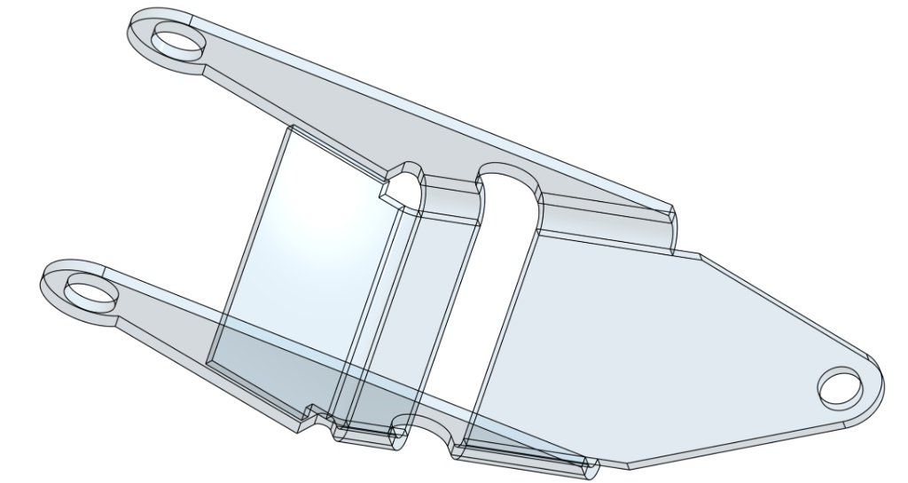

# Onshape-Grade Visual Polish: Razor-Sharp Screen-Space Borders, Split Normals, GGX Plastic/Anodized Shading & Translucent Mode (v4.0)

## Role & Objective for the Coding Agent
You are fixing the **6 visual rendering defects** identified by comparing our app's current viewport (**SS1 & SS2**) against Onshape's production viewport (**SS3, SS4, and SS5**). Apply this specification across both `flutter_scene_cad_mesh_builder.dart` (Flutter GPU) and `flutter_paint_3d_engine.dart` (2D `Canvas` fallback), strictly using single-precision `package:vector_math/vector_math.dart`.

## 1. Visual Diagnosis: Why SS1 & SS2 Do Not Look Like Onshape (SS3, SS4, SS5)

| Defect Observed in SS1 & SS2 | Root Cause in Current Code | Onshape Reference (SS3, SS4, SS5) & v4.0 Fix |
| :--- | :--- | :--- |
| **1. Thick, Marker-Like Borders & 3D Corner "Ears" (Circled in SS1 & SS2)** | `CadEdgeBuilder` extrudes 3D ribbons in **world units** (`worldHalfWidth = 0.06`) along each face's `surfaceNormal`. Zooming in scales ribbons to `8–14px` thick, and each face's miter overshoots the 3D corner in its own plane, creating overlapping black "chopstick ears." | **Screen-Space Constant `1.15px` Hairlines + Deduplicated 3D Edges:** Compute line width in **NDC/Screen pixels** (`1.15px` constant at any zoom), deduplicate shared 3D crease edges so each edge is drawn once (12 edges per box, not 24), and clamp miter extensions (`<= 1.15`) with round joins. |
| **2. "Centipede / Eyelash" Spikes Around Circular Holes (Circled & Arrowed in SS1 & SS2)** | 1) Duplicate start/end points in closed hole loops cause `(curr - prev).normalized()` to divide by zero (`NaN`), flipping miter normals radially. 2) Internal vertical cylinder bore seams or earcut fan edges are leaking into edge rendering. | **Strict Topological Edge Filter + Sanitized Circle Loops:** Remove duplicate consecutive vertices before computing miters, emit **only** the 2 closed circular rim loops per hole (zero vertical bore lines, zero earcut bridge lines), and project hole rim miter offsets in screen space. |
| **3. Diagonal Crack Line Across Flat Faces (SS1 & SS2)** | Adjacent coplanar triangles filled on 2D `Canvas` (`flutter_paint_3d_engine.dart`) suffer from antialiased alpha-coverage seams (`50% + 50% < 100%`) along the shared diagonal hypotenuse. | **Coplanar Face Merging / Seam Sealing:** Seal interior triangle edges with a `0.4px` same-color fill-stroke (`PaintingStyle.stroke`) or merge coplanar face polygons into a single `Path` so flat walls are 100% seamless. |
| **4. Blown-Out White Streak on Flat Walls (SS2 Bottom-Left Wall)** | The rectangular box shares averaged vertex normals across 90° corners, causing the shader to interpolate normals across a flat face like a curved pillow and clip raw additive `vec3(1.0) * spec` to pure white. | **Strict Split Normals on 90° Edges + Energy-Conserving GGX Shader:** Every flat face uses constant un-averaged normals (24 vertices per box). Specular highlights appear **only** on curved fillets and cylinders using tone-mapped GGX microfacet shading. |
| **5. Dead Gray Color vs. Onshape's Tactile "Plasticky / Solid" Feel (SS3 & SS4)** | Single flat directional light with desaturated gray (`#C2C8CC`) and no crevice darkening or Fresnel rim response. | **Onshape 3-Light Studio Rig + Hemisphere Bounce + Crevice AO + Fresnel Rim:** Combines a key light, warm-cool hemisphere sky/ground gradient, subtle Fresnel grazing sheen, and vertex Ambient Occlusion (`a_ao`) darkening inside holes and concave bends. |
| **6. Missing Frosted-Glass Translucent Mode (SS5)** | Current renderer only supports opaque triangles. | **Onshape Translucent Mode (`CadRenderStyle.translucent`):** Renders all topological edges (front + dimmed back hidden edges) over Fresnel-weighted translucent surfaces (`alpha: 0.26–0.48`, `depthWrite: false`). |

## 2. Fix 1 & 2: Screen-Space Constant `1.15px` Topological Edge Builder & Shaders

### Why World-Space `surfaceNormal` Ribbons Must Be Replaced
When two faces meet at a 90° corner, a ribbon lying in the top face's plane and a ribbon lying in the front wall's plane cannot miter cleanly in 3D world space—they cross past the corner vertex and stick out into empty air (the blue circles in SS1 and SS2).
Instead, store **each unique 3D topological edge once** as segment pairs `(pointA, pointB)` and expand the quad ribbon **in 2D screen space inside the vertex shader** (for Flutter GPU) or draw with fixed `strokeWidth: 1.15` + `StrokeJoin.round` (for Canvas fallback).

### `lib/rendering/cad_topological_edge_builder.dart`
```dart
import 'dart:math';
import 'dart:typed_data';
import 'package:vector_math/vector_math.dart';

class CadScreenSpaceLineMeshData {
  /// Interleaved 7 floats per vertex:
  /// [posAx, posAy, posAz, posBx, posBy, posBz, sideAndEndSelect]
  /// where sideAndEndSelect encodes endpoint (A vs B) and perpendicular side (-1 vs +1).
  final Float32List vertexData;
  final Uint16List indices;

  /// Raw deduplicated 3D polylines for the 2D Canvas Fallback Painter
  final List<({List<Vector3> points, bool closed})> polylines;

  CadScreenSpaceLineMeshData({
    required this.vertexData,
    required this.indices,
    required this.polylines,
  });
}

class CadEdgeBuilder {
  final List<double> _verts = [];
  final List<int> _indices = [];
  final List<({List<Vector3> points, bool closed})> _polylines = [];
  final Set<String> _dedupedSegments = {};
  int _vertexCount = 0;

  /// Adds a topological feature loop or polyline.
  /// Automatically strips near-duplicate consecutive vertices (fixing hole spikes)
  /// and deduplicates shared 3D crease segments (fixing 3D box corner overhangs).
  void addPolyline(
    List<Vector3> rawPoints, {
    Vector3? surfaceNormal, // Kept optional for API compatibility; not used for world extrusion
    double worldHalfWidth = 0.02,
    bool closed = true,
  }) {
    // 1. Sanitize points: remove consecutive duplicates that cause NaN miter spikes on holes!
    final List<Vector3> pts = [];
    for (final p in rawPoints) {
      if (pts.isEmpty || pts.last.distanceToSquared(p) > 1e-8) {
        pts.add(p.clone());
      }
    }
    if (closed && pts.length > 1 && pts.first.distanceToSquared(pts.last) <= 1e-8) {
      pts.removeLast();
    }
    if (pts.length < 2) return;

    _polylines.add((points: pts, closed: closed));

    // 2. Emit deduplicated 3D segments for screen-space quad expansion
    final int segCount = closed ? pts.length : pts.length - 1;
    for (int i = 0; i < segCount; i++) {
      final Vector3 a = pts[i];
      final Vector3 b = pts[(i + 1) % pts.length];
      if (a.distanceToSquared(b) <= 1e-8) continue;

      final String key = _segmentKey(a, b);
      if (!_dedupedSegments.add(key)) {
        // Shared crease edge between two adjacent faces was already emitted!
        continue;
      }

      _emitScreenSpaceSegmentQuad(a, b);
    }
  }

  void _emitScreenSpaceSegmentQuad(Vector3 a, Vector3 b) {
    final int base = _vertexCount;

    // 4 vertices per segment:
    // sideAndEndSelect:
    //  -1.0 = Endpoint A, Left  (-1)
    //  +1.0 = Endpoint A, Right (+1)
    //  -2.0 = Endpoint B, Left  (-1)
    //  +2.0 = Endpoint B, Right (+1)
    for (final double code in [-1.0, 1.0, -2.0, 2.0]) {
      _verts.addAll([a.x, a.y, a.z, b.x, b.y, b.z, code]);
      _vertexCount++;
    }

    _indices.addAll([
      base,
      base + 1,
      base + 2,
      base + 1,
      base + 3,
      base + 2,
    ]);
  }

  static String _segmentKey(Vector3 p1, Vector3 p2) {
    String fmt(Vector3 v) =>
        '${(v.x * 1000).round()}_${(v.y * 1000).round()}_${(v.z * 1000).round()}';
    final String k1 = fmt(p1);
    final String k2 = fmt(p2);
    return (k1.compareTo(k2) <= 0) ? '$k1|$k2' : '$k2|$k1';
  }

  CadScreenSpaceLineMeshData build() => CadScreenSpaceLineMeshData(
        vertexData: Float32List.fromList(_verts),
        indices: Uint16List.fromList(_indices),
        polylines: List.unmodifiable(_polylines),
      );
}
```

### Updated `shaders/cad_line.vert` & `shaders/cad_line.frag` (Constant `1.15px` Screen-Space Hairlines)
Instead of extruding in world units, this vertex shader projects both endpoints `a_posA` and `a_posB` to NDC screen space and offsets perpendicular to the 2D screen tangent by `u_lineWidthPx / u_viewportSize`. Corners and hole rims remain razor-sharp `1.15px` lines at any zoom level!

```glsl
// shaders/cad_line.vert
#version 460 core

layout(location = 0) in vec3 a_posA;
layout(location = 1) in vec3 a_posB;
layout(location = 2) in float a_code; // -1,+1 for endpoint A; -2,+2 for endpoint B

uniform mat4 u_mvp;
uniform vec2 u_viewportSize; // e.g. vec2(1920.0, 1080.0)
uniform float u_lineWidthPx; // Default Onshape hairline: 1.25

layout(location = 0) out float v_edgeCoord;

void main() {
  vec4 clipA = u_mvp * vec4(a_posA, 1.0);
  vec4 clipB = u_mvp * vec4(a_posB, 1.0);

  vec2 ndcA = clipA.xy / max(clipA.w, 0.0001);
  vec2 ndcB = clipB.xy / max(clipB.w, 0.0001);

  vec2 screenDelta = (ndcB - ndcA) * (u_viewportSize * 0.5);
  float segLen = length(screenDelta);
  vec2 dir = (segLen > 0.001) ? (screenDelta / segLen) : vec2(1.0, 0.0);
  vec2 normal2D = vec2(-dir.y, dir.x);

  bool isEndB = abs(a_code) > 1.5;
  float side = sign(a_code); // -1.0 or +1.0

  vec4 activeClip = isEndB ? clipB : clipA;

  // Sub-pixel cap extension (0.35px) so segments join seamlessly at corners without ears!
  vec2 capExtend = dir * (isEndB ? 0.35 : -0.35);
  vec2 pixelOffset = (normal2D * (side * u_lineWidthPx * 0.5)) + capExtend;

  // Convert pixel offset back to clip space
  activeClip.xy += (pixelOffset / (u_viewportSize * 0.5)) * activeClip.w;

  // Pull line slightly toward camera to prevent Z-fighting on flat plates and hole rims
  activeClip.z -= 0.00045 * activeClip.w;

  v_edgeCoord = side;
  gl_Position = activeClip;
}
```

```glsl
// shaders/cad_line.frag
#version 460 core

layout(location = 0) in float v_edgeCoord;
uniform float u_opacity; // 0.88 in opaque mode, 0.55 for translucent back-edges

layout(location = 0) out vec4 fragColor;

void main() {
  float dist = abs(v_edgeCoord);
  float aa = fwidth(dist);
  float alpha = (1.0 - smoothstep(1.0 - aa * 1.4, 1.0, dist)) * u_opacity;

  // Onshape dark slate-charcoal border color (#1E2730 — softer & cleaner than #000000)
  fragColor = vec4(0.118, 0.153, 0.188, alpha);
}
```

## 3. Fix 3 & 4: Strict Split Normals on Boxes/Walls & Zero Hole Spikes in `CadSolidBuilder`

### Why SS2 Had a Blown-Out White Streak on the Box Wall
In SS2, the rectangular block was built with shared corner vertices (or misoriented normals), causing the GPU to interpolate normals across flat walls.
**Rule:** Every flat wall, plate, and rectangular box side MUST emit **4 dedicated vertices per quad face** with the exact constant face normal $\mathbf{N} = \text{normalize}(\mathbf{E}_1 \times \mathbf{E}_2)$, and `addCylindricalHole` must emit **zero vertical line segments**.

### `lib/rendering/cad_solid_builder_v4.dart`
```dart
import 'dart:math';
import 'dart:typed_data';
import 'package:vector_math/vector_math.dart';
import 'cad_topological_edge_builder.dart';

class CadSurfaceMeshData {
  /// Interleaved 7 floats per vertex:
  /// [posX, posY, posZ, normX, normY, normZ, ambientOcclusion]
  /// ambientOcclusion in [0.0..1.0] darkens interior hole bores & concave fillet roots!
  final Float32List vertices;
  final Uint16List indices;
  CadSurfaceMeshData(this.vertices, this.indices);
}

class CadSolidBuilderV4 {
  final List<double> _verts = [];
  final List<int> _indices = [];
  int _vertexCount = 0;

  int _addVertex(Vector3 pos, Vector3 normal, {double ao = 1.0}) {
    _verts.addAll([
      pos.x,
      pos.y,
      pos.z,
      normal.x,
      normal.y,
      normal.z,
      ao,
    ]);
    return _vertexCount++;
  }

  /// Builds a crisp, flat-shaded 3D box/wall with 24 split vertices (4 per face, zero normal averaging!)
  /// and 12 deduplicated topological border edges (zero corner overhangs!).
  void addSharpBox({
    required Vector3 minCorner,
    required Vector3 maxCorner,
    required CadEdgeBuilder edgeBuilder,
  }) {
    final c000 = Vector3(minCorner.x, minCorner.y, minCorner.z);
    final c100 = Vector3(maxCorner.x, minCorner.y, minCorner.z);
    final c110 = Vector3(maxCorner.x, maxCorner.y, minCorner.z);
    final c010 = Vector3(minCorner.x, maxCorner.y, minCorner.z);
    final c001 = Vector3(minCorner.x, minCorner.y, maxCorner.z);
    final c101 = Vector3(maxCorner.x, minCorner.y, maxCorner.z);
    final c111 = Vector3(maxCorner.x, maxCorner.y, maxCorner.z);
    final c011 = Vector3(minCorner.x, maxCorner.y, maxCorner.z);

    void addFlatQuad(Vector3 p0, Vector3 p1, Vector3 p2, Vector3 p3, Vector3 n) {
      final int b = _vertexCount;
      _addVertex(p0, n);
      _addVertex(p1, n);
      _addVertex(p2, n);
      _addVertex(p3, n);
      _indices.addAll([b, b + 1, b + 2, b, b + 2, b + 3]);

      // Emit topological border loop (CadEdgeBuilder automatically deduplicates shared edges!)
      edgeBuilder.addPolyline([p0, p1, p2, p3], closed: true);
    }

    addFlatQuad(c001, c101, c111, c011, Vector3(0, 0, 1));  // Front (+Z)
    addFlatQuad(c100, c000, c010, c110, Vector3(0, 0, -1)); // Back (-Z)
    addFlatQuad(c011, c111, c110, c010, Vector3(0, 1, 0));  // Top (+Y)
    addFlatQuad(c000, c100, c101, c001, Vector3(0, -1, 0)); // Bottom (-Y)
    addFlatQuad(c101, c100, c110, c111, Vector3(1, 0, 0));  // Right (+X)
    addFlatQuad(c000, c001, c011, c010, Vector3(-1, 0, 0)); // Left (-X)
  }

  /// Builds a high-resolution cylindrical hole bore with:
  /// - Smooth radial inward normals (for Onshape interior bore shading)
  /// - Subtle interior Ambient Occlusion (`ao: 0.78` top, `0.68` bottom)
  /// - ONLY 2 clean circular rim loops (zero vertical spike lines!)
  void addCylindricalHole({
    required Vector3 centerTop,
    required Vector3 plateNormal,
    required double radius,
    required double depth,
    required CadEdgeBuilder edgeBuilder,
  }) {
    final int segments = _getSegmentsForCircle(radius);

    final Vector3 n = plateNormal.normalized();
    final Vector3 helper =
        n.x.abs() < 0.9 ? Vector3(1, 0, 0) : Vector3(0, 1, 0);
    final Vector3 tangent = n.cross(helper).normalized();
    final Vector3 bitangent = n.cross(tangent).normalized();

    final int baseIdx = _vertexCount;
    final List<Vector3> topRimPoints = [];
    final List<Vector3> bottomRimPoints = [];

    for (int i = 0; i <= segments; i++) {
      final double angle = (2.0 * pi * i) / segments;
      final Vector3 radialOut =
          (tangent * cos(angle) + bitangent * sin(angle)).normalized();

      final Vector3 topPos = centerTop + radialOut * radius;
      final Vector3 botPos = topPos - n * depth;

      final Vector3 inwardNormal = -radialOut;
      _addVertex(topPos, inwardNormal, ao: 0.86);
      _addVertex(botPos, inwardNormal, ao: 0.72);

      // Strictly collect < segments unique points so start & end never duplicate!
      if (i < segments) {
        topRimPoints.add(topPos);
        bottomRimPoints.add(botPos);
      }
    }

    for (int i = 0; i < segments; i++) {
      final int b = baseIdx + i * 2;
      _indices.addAll([b, b + 1, b + 2, b + 1, b + 3, b + 2]);
    }

    // Emit ONLY the 2 circular rim loops (top and bottom)
    edgeBuilder.addPolyline(topRimPoints, closed: true);
    edgeBuilder.addPolyline(bottomRimPoints, closed: true);
  }

  static int _getSegmentsForCircle(double radius, {double maxChordError = 0.02}) {
    final double ratio = (maxChordError / radius).clamp(0.0001, 0.5);
    final double angle = 2.0 * acos(1.0 - ratio);
    final int segments = (2.0 * pi / angle).ceil();
    return segments.clamp(48, 96);
  }

  CadSurfaceMeshData build() => CadSurfaceMeshData(
        Float32List.fromList(_verts),
        Uint16List.fromList(_indices),
      );
}
```

## 4. Fix 5 & 6: Onshape Studio GGX "Plasticky / Solid" Shader + Translucent Mode (SS3, SS4, SS5)

### Why Onshape's Shading Looks So Satisfying (SS3, SS4, SS5)
1. **Rich Saturated CAD Base Colors (Not Dead Gray):**
   * **Onshape Classic Blue (SS3):** `vec3(0.455, 0.612, 0.745)` (`#749CBE`)
   * **Onshape Gloss Teal (SS4 Mug):** `vec3(0.055, 0.525, 0.510)` (`#0E8682`)
   * **Onshape Frosted Glass (SS5 Translucent):** `vec3(0.84, 0.90, 0.96)` (`#D6E6F5`)
2. **3-Point Studio Rig + Cool/Warm Hemisphere Environment:**
   * Instead of a single harsh spotlight, Onshape blends a **Top-Left Key Light**, a **Bottom-Right Rim/Fill Light**, and a **View-Space Sky-to-Ground Hemisphere Gradient** (`mix(groundColor, skyColor, N.y * 0.5 + 0.5)`). Flat faces receive a silky, uniform studio tone with zero blown-out white streaks.
3. **Energy-Conserving GGX Specular + Schlick Fresnel:**
   * Produces the tight, glossy, injection-molded "plasticky / anodized" highlight seen on the curved mug in SS4 and the sheet-metal fillets in SS3 without clipping flat faces to white.

### `shaders/cad_surface.frag` (Supports Both Solid SS3/SS4 and Translucent SS5!)
```glsl
#version 460 core

layout(location = 0) in vec3 v_viewNormal;
layout(location = 1) in vec3 v_viewPos;
layout(location = 2) in float v_ao; // 1.0 on outer surfaces, 0.72..0.86 inside holes/crevices

uniform vec3 u_baseColor;      // e.g. Onshape Blue vec3(0.455, 0.612, 0.745) or Teal vec3(0.055, 0.525, 0.510)
uniform float u_roughness;     // Default: 0.24 for Onshape satin-plastic / anodized feel
uniform float u_opacity;       // 1.0 for Solid mode (SS3/SS4), 0.28 for Translucent mode (SS5)

layout(location = 0) out vec4 fragColor;

const float PI = 3.14159265359;

// GGX / Trowbridge-Reitz Normal Distribution Function
float distributionGGX(vec3 N, vec3 H, float roughness) {
  float a = roughness * roughness;
  float a2 = a * a;
  float NdotH = max(dot(N, H), 0.0);
  float NdotH2 = NdotH * NdotH;
  float denom = (NdotH2 * (a2 - 1.0) + 1.0);
  return a2 / max(PI * denom * denom, 0.0001);
}

// Schlick Fresnel approximation (gives edges that tactile solid/plastic rim sheen)
vec3 fresnelSchlick(float cosTheta, vec3 F0) {
  return F0 + (1.0 - F0) * pow(clamp(1.0 - cosTheta, 0.0, 1.0), 5.0);
}

void main() {
  // Support two-sided normal orientation for thin walls and Translucent Mode (SS5)
  vec3 N = normalize(gl_FrontFacing ? v_viewNormal : -v_viewNormal);
  vec3 V = normalize(-v_viewPos);

  // 1. View-Space Studio Lights (locked to camera so orbiting is always well-lit)
  vec3 L_key  = normalize(vec3(-0.32, 0.42, 0.85)); // Top-left studio key light
  vec3 L_fill = normalize(vec3(0.48, -0.25, 0.84)); // Soft bottom-right fill light
  vec3 L_rim  = normalize(vec3(0.0, 0.85, -0.52));  // Subtle top-back rim light

  vec3 H_key = normalize(V + L_key);

  float NdotV = max(dot(N, V), 0.001);
  float NdotL_key  = max(dot(N, L_key), 0.0);
  float NdotL_fill = max(dot(N, L_fill), 0.0);
  float NdotL_rim  = max(dot(N, L_rim), 0.0);

  // 2. Studio Hemisphere Sky/Ground Ambient (eliminates flat dead-gray look)
  vec3 skyAmbient    = u_baseColor * vec3(1.06, 1.08, 1.12);
  vec3 groundAmbient = u_baseColor * vec3(0.62, 0.65, 0.70);
  vec3 hemiAmbient   = mix(groundAmbient, skyAmbient, N.y * 0.5 + 0.5) * 0.42;

  // 3. Wrap-Around Studio Diffuse (smooth tonal separation between 90° walls)
  float wrapKey  = (dot(N, L_key) + 0.25) / 1.25;
  float diffTerm = max(wrapKey, 0.0) * 0.52 + NdotL_fill * 0.22 + NdotL_rim * 0.08;
  vec3 diffuse   = u_baseColor * diffTerm;

  // 4. Energy-Conserving GGX Plastic/Anodized Specular (SS3 & SS4 glossy highlight)
  vec3 F0 = vec3(0.045); // Dielectric plastic/anodized coat reflectance
  vec3 F  = fresnelSchlick(max(dot(H_key, V), 0.0), F0);
  float D = distributionGGX(N, H_key, u_roughness);
  vec3 specular = (D * F * NdotL_key) * 0.28;

  // Subtle grazing Fresnel rim glow for tactile 3D volume
  float rimSheen = pow(1.0 - NdotV, 3.5) * 0.09;

  // Combine with Crevice Ambient Occlusion (v_ao) and Reinhard soft highlight roll-off
  vec3 litColor = (hemiAmbient + diffuse) * v_ao + specular + vec3(rimSheen);
  litColor = litColor / (litColor + vec3(0.18)) * 1.18; // Prevents harsh white clipping!

  // 5. Handle Solid Mode (SS3/SS4) vs. Onshape Translucent Mode (SS5)
  if (u_opacity < 0.99) {
    // In Translucent mode (SS5), boost opacity slightly at grazing angles like frosted glass
    float glassFresnel = mix(u_opacity, min(u_opacity * 1.85, 0.65), pow(1.0 - NdotV, 2.2));
    vec3 glassColor = mix(litColor, vec3(0.86, 0.92, 0.97), 0.35);
    fragColor = vec4(glassColor, glassFresnel);
  } else {
    fragColor = vec4(litColor, 1.0);
  }
}
```

## 5. Dual-Pipeline Symmetry: Fixing `flutter_paint_3d_engine.dart` (2D Canvas Fallback)

In the 2D `Canvas` fallback (`flutter_paint_3d_engine.dart`), apply the exact same 6 visual fixes so Windows desktop and widget tests match Onshape's SS3, SS4, and SS5:

```dart
import 'dart:math';
import 'package:flutter/material.dart';
import 'package:vector_math/vector_math.dart' hide Colors;
import 'cad_topological_edge_builder.dart';

enum CadDisplayMode {
  shadedWithEdges, // SS3 & SS4: Solid GGX plastic/anodized shading + 1.15px #1E2730 edges
  translucent,     // SS5: Frosted glass translucent surfaces + visible hidden back-edges
}

class OnshapeCanvas3DPainter {
  /// Computes the exact same Studio Hemisphere + GGX Plastic/Anodized color per triangle
  /// for the 2D Canvas Fallback pipeline (`flutter_paint_3d_engine.dart`).
  static Color computeOnshapeStudioColor({
    required Vector3 viewNormal,
    required Vector3 viewPos,
    required Color baseColor,
    double roughness = 0.24,
    double ao = 1.0,
    bool isTranslucent = false,
  }) {
    final Vector3 N = viewNormal.normalized();
    final Vector3 V = (-viewPos).normalized();

    final Vector3 lKey = Vector3(-0.32, 0.42, 0.85).normalized();
    final Vector3 lFill = Vector3(0.48, -0.25, 0.84).normalized();
    final Vector3 hKey = (V + lKey).normalized();

    final double nDotV = max(N.dot(V).abs(), 0.001);
    final double nDotLKey = max(N.dot(lKey), 0.0);
    final double nDotLFill = max(N.dot(lFill), 0.0);
    final double nDotH = max(N.dot(hKey), 0.0);

    // Studio hemisphere ambient + wrap diffuse
    final double hemiFactor = (N.y * 0.5 + 0.5) * 0.16 + 0.34;
    final double wrapKey = max((N.dot(lKey) + 0.25) / 1.25, 0.0);
    final double diffuseFactor = (wrapKey * 0.52 + nDotLFill * 0.22) * ao;

    // GGX specular highlight (concentrated on curved fillets/bores, never clips flat walls)
    final double a2 = pow(roughness, 4).toDouble();
    final double denom = (nDotH * nDotH * (a2 - 1.0) + 1.0);
    final double dGgx = a2 / max(pi * denom * denom, 0.001);
    final double spec = min(dGgx * nDotLKey * 0.045, 0.42);

    final double totalTone = (hemiFactor + diffuseFactor).clamp(0.25, 1.05);

    double r = (baseColor.r * totalTone + spec).clamp(0.0, 1.0);
    double g = (baseColor.g * totalTone + spec).clamp(0.0, 1.0);
    double b = (baseColor.b * totalTone + spec).clamp(0.0, 1.0);

    if (isTranslucent) {
      // SS5 Translucent frosted glass tint + Fresnel edge opacity
      r = r * 0.65 + 0.86 * 0.35;
      g = g * 0.65 + 0.92 * 0.35;
      b = b * 0.65 + 0.97 * 0.35;
      final double alpha =
          (0.26 + 0.24 * pow(1.0 - nDotV, 2.2)).clamp(0.22, 0.55);
      return Color.from(alpha: alpha, red: r, green: g, blue: b);
    }

    return Color.from(alpha: 1.0, red: r, green: g, blue: b);
  }

  /// Renders a triangle on 2D Canvas with a 0.4px same-color seam sealer
  /// to eliminate the diagonal hypotenuse crack seen in SS1 and SS2!
  static void drawSeamlessTriangle(
    Canvas canvas,
    Offset p0,
    Offset p1,
    Offset p2,
    Color shadedColor, {
    required bool isTranslucent,
  }) {
    final Path triPath = Path()
      ..moveTo(p0.dx, p0.dy)
      ..lineTo(p1.dx, p1.dy)
      ..lineTo(p2.dx, p2.dy)
      ..close();

    canvas.drawPath(
      triPath,
      Paint()
        ..color = shadedColor
        ..style = PaintingStyle.fill
        ..isAntiAlias = true,
    );

    // Seal internal earcut/quad diagonal seams in solid mode so flat faces look 100% solid!
    if (!isTranslucent) {
      canvas.drawPath(
        triPath,
        Paint()
          ..color = shadedColor
          ..style = PaintingStyle.stroke
          ..strokeWidth = 0.45
          ..strokeJoin = StrokeJoin.round
          ..isAntiAlias = true,
      );
    }
  }

  /// Renders deduplicated topological edges as constant 1.15px Onshape Slate (#1E2730) hairlines
  /// with round joins and round caps (zero corner overhangs, zero hole spikes!).
  static void drawTopologicalEdges(
    Canvas canvas,
    Size viewportSize,
    Matrix4 vpMatrix,
    CadScreenSpaceLineMeshData edgeMesh, {
    bool isTranslucentMode = false,
  }) {
    final Paint edgePaint = Paint()
      ..color = Color.from(
        alpha: isTranslucentMode ? 0.72 : 0.90,
        red: 0.118,
        green: 0.153,
        blue: 0.188,
      ) // #1E2730 Onshape charcoal-slate
      ..style = PaintingStyle.stroke
      ..strokeWidth = 1.15 // Constant razor-sharp hairline regardless of camera zoom!
      ..strokeCap = StrokeCap.round
      ..strokeJoin = StrokeJoin.round
      ..isAntiAlias = true;

    for (final poly in edgeMesh.polylines) {
      final Path path = Path();
      bool started = false;

      for (final Vector3 pt3D in poly.points) {
        final Vector4 clip =
            vpMatrix.transform(Vector4(pt3D.x, pt3D.y, pt3D.z, 1.0));
        if (clip.w <= 0.0001) continue;

        final double sx = ((clip.x / clip.w) + 1.0) * 0.5 * viewportSize.width;
        final double sy = (1.0 - (clip.y / clip.w)) * 0.5 * viewportSize.height;

        if (!started) {
          path.moveTo(sx, sy);
          started = true;
        } else {
          path.lineTo(sx, sy);
        }
      }

      if (started && poly.closed) {
        path.close();
      }
      canvas.drawPath(path, edgePaint);
    }
  }
}
```

## 6. Verification Checklist for the Coding Agent
- [ ] **Corner Overhangs ("Ears") Gone (SS1 & SS2 Blue Circles):** `CadEdgeBuilder` deduplicates shared 3D segments (`_dedupedSegments`) and expands line width in **screen pixels (`1.15px`)** with `0.35px` round/bevel caps instead of world-space `surfaceNormal` ribbons.
- [ ] **Circular Hole Spikes Gone (SS1 & SS2 Hole Arrows):** Consecutive duplicate vertices are stripped in `CadEdgeBuilder.addPolyline()`, and `addCylindricalHole()` emits **only** the top and bottom circular rim loops (zero vertical bore segment lines).
- [ ] **Diagonal Face Cracks Gone (SS1 & SS2 Flat Faces):** `OnshapeCanvas3DPainter.drawSeamlessTriangle()` seals internal triangle edges with a `0.45px` same-color stroke in solid mode, and never strokes internal triangulation edges in black.
- [ ] **No Blown-Out White Streaks on Flat Walls (SS2 Bottom-Left Wall):** All flat walls and boxes use 24 split vertices (`addSharpBox`) with constant per-face normals and energy-conserving GGX specular roll-off.
- [ ] **Onshape Translucent Mode (`SS5`) Supported:** Setting `u_opacity = 0.28` / `CadDisplayMode.translucent` renders frosted-glass Fresnel surfaces with visible `1.15px` internal and back-facing topological feature lines.
