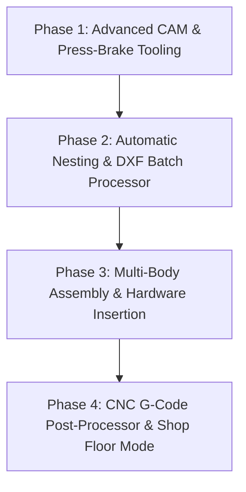

# TruFold Studio Studio (DSF Studio) — Master Architecture, Feature Audit & Next Steps Handover

---

## 1. Executive Summary

**TruFold Studio Studio (DSF Studio)** is a self-contained, industrial-grade sheet metal CAD/CAM and forward-kinematic 3D folding application module developed in 100% pure Flutter/Dart.

It bridges the gap between **2D flat blank engineering** (laser profiling, CNC turret punching, press-brake layout) and **3D parametric assembly verification**. It allows sheet metal engineers, draftsmen, and CNC operators to:
1. Ingest flat developed CAD patterns (DXF R12/2000 or native `.dsf` format).
2. Segment planar sheet blanks into interconnected panel networks using finite line segment slicing.
3. Interactively fold the sheet metal in real-time from $0\%$ (completely flat blank) to $100\%$ (fully formed 3D product) using arbitrary 3D axis-angle Rodrigues rotations along press-brake bend vectors.
4. Foreshorten 2D panels on the drawing board as folds occur, with faint dashed ghosted reference outlines of the original flat pattern.
5. Stamp, position, and drag CNC Turret Punches (Round holes, Obround slots, Rectangles) with live CAD Studio style edge and bend distance constraints.
6. Author bend lines and laser cuts with rubber-band cursor tracking, automatic 45°/orthogonal angle snapping, <kbd>Alt</kbd> continuous rotation bypass, open bend warnings, and endpoint drag-to-edge snapping.
7. Export complete manufacturing packages to **.dsf**, **.dxf**, **.obj**, **.stl**, and **.dds**.

---

## 2. Standalone Portability & Zero-Dependency Guarantee

The module `lib/modules/sheet_metal_studio/` is built with **zero external package dependencies** and **zero coupling** to any specific app database or UI framework beyond standard Flutter:
- No external packages in `pubspec.yaml` (pure Dart `dart:math`, `dart:convert`, and `package:flutter/material.dart`).
- Zero imports of parent app models, screens, or database state.
- Standalone extraction: simply copy `lib/modules/sheet_metal_studio/` and `test/modules/sheet_metal_studio/` into any Flutter project.
- Launch command:
  ```dart
  import 'modules/sheet_metal_studio/views/sheet_metal_studio_screen.dart';

  // Run as standalone root screen
  runApp(const MaterialApp(home: SheetMetalStudioScreen()));

  // Or launch from existing screen
  SheetMetalStudioScreen.open(context, initialDocument: myDoc);
  ```

---

## 3. Comprehensive Feature Catalog

### 3.1 Dual-Viewport CAD Workspace
- **SolidWorks-Style Dual Viewport**: Left side hosts the interactive 2D unfolded drawing board; right side hosts the 3D kinematic folding viewport.
- **Interactive Split Pane**: Draggable splitter bar with hover glow, mouse cursor cues, clamp boundaries ($20\% - 80\%$), and double-tap to reset to an exact 50/50 split.
- **Viewport Isolation**: Wrapped in `ClipRect` to prevent graphical bleed into the header, toolbar, or adjacent panels during extreme zoom/pan.
- **Light Theme**: High-contrast, clean slate background (`#F8FAFC`) with subtle millimeter grid lines.
- **Mouse Wheel Zooming**: Independent zoom for both 2D and 3D canvases.
- **3D Camera Controls**:
  - Left-drag: Turntable azimuth/elevation orbit.
  - Middle-mouse button drag OR <kbd>Shift</kbd>+Left drag: Continuous camera panning.
  - Mouse wheel: Smooth dolly zoom.
  - Camera preset buttons: Top (Plan), Isometric, Front, and Reset.
- **Selection Clearing**: Clicking empty canvas background cleanly deselects all active objects.

### 3.2 Rubber-Band Bend & Laser Cut Authoring
- **Interactive Rubber-Band Creation**: Click 1 sets the start point; the line dynamically tracks the cursor with a dashed preview and on-screen angle pill. Click 2 sets the endpoint.
- **Automatic 45° / Orthogonal Angle Snapping**: Automatically snaps to $0^\circ, 45^\circ, 90^\circ, 135^\circ, 180^\circ, 225^\circ, 270^\circ, 315^\circ$.
- **<kbd>Alt</kbd> Key Override**: Holding <kbd>Alt</kbd> unlocks continuous 360° rotation.
- **Open / Incomplete Bend Handling**:
  - `PlanarFaceDecomposer` enforces finite line segment intersection. Bends that do not span edge-to-edge do not slice the face or crash the 3D model.
  - Renders an amber `⚠️ INCOMPLETE BEND` warning badge and endpoint warning rings.
  - Draggable $P_1$ and $P_2$ endpoint handles allow engineers to drag endpoints onto workpiece edges, corners, or intersecting bend lines.
- **Laser Cut Line Tool (`+ Cut`)**: Dedicated laser slit and cut line tool (`Icons.content_cut`) stored on the `CUT` layer with full DXF and 3D export compatibility.

### 3.3 CNC Turret Punching & Edge Constraints
- **Punch Types**: Round tooling holes, Obround slots, and Rectangular/Square punches.
- **CAD Studio Style Constraints**:
  - Live orthogonal leader lines with distance badges in millimeters from Left, Right, Top, Bottom edges, and the nearest bend line.
  - Editable constraint values: typing a distance immediately shifts the punch to that exact dimension.
- **Dynamic Arc Curvature**: Changing Obround width/height automatically updates the tangential end arc radiuses.
- **Immediate 3D Rendering**: Holes are punched directly into planar faces and appear immediately on folded 3D parts.
- **Corner Treatments**: 45° miter chamfers and cubic Bezier fillets applied to workpiece corners.

### 3.4 Kinematic 3D Folding Engine
- **Directed Acyclic Graph (DAG)**: Automatically builds topological relationships rooted at the base anchor face.
- **Rodrigues Rotation Formulation**: Computes arbitrary 3D rotations about press-brake bend axes.
- **Fold Progress Slider**: Interactive slider from $0\%$ (flat blank) to $100\%$ (folded part) with auto-play animation and smooth cubic easing.
- **2D Panel Foreshortening**: 2D panels contract dynamically during folding, showing ghosted outlines of the flat blank.

### 3.5 CAD/CAM Exporters & Importers
- **AutoCAD DXF**: Generates standard DXF R12/2000 with CNC layers (`CUT`, `BEND_UP`, `BEND_DOWN`, `HOLES`, `ANNOTATION`).
- **Wavefront OBJ**: Exports 3D mid-surface or extruded solid bodies with sheet metal thickness.
- **Stereolithography STL**: Exports 3D ASCII meshes for slicers, 3D printing, and CAM.
- **Danish Sheet Fold (.dsf)**: Native JSON document encapsulating 2D/3D geometry, material properties, and kinematics.
- **Danish Datasheet (.dds)**: Bundles project metadata, bend sequence, and 3D camera state.

### 3.6 History & State Management
- **Full Undo / Redo Engine** (<kbd>Ctrl+Z</kbd> / <kbd>Ctrl+Y</kbd>) across all actions.
- **Single-Step Drag Recording**: Multi-frame object drags collapse into a single undo step on mouse button release.
- **Floating Draggable Property Sheets**: Property inspectors for bends and punches can be freely dragged across the canvas.

---

## 4. Chronological Log of User Requests & Implementation Details

| Request | Description | Solution / Implementation |
|---|---|---|
| **R1. Standalone Architecture** | Make it an independent app; able to copy the folder into another app; include `.md` manual. | Created `lib/modules/sheet_metal_studio/` with 0 external dependencies; authored `README.md`. |
| **R2. Dual Viewport & Splitter** | Split screen with right 50% 3D viewer; draggable split ratio. | Built `split_pane_divider.dart` with hover glow, clamp boundaries, and double-tap 50/50 reset. |
| **R3. Interactive 2D Foreshortening** | As fold slider moves, flat drawing changes interactively. | Implemented dynamic foreshortening in `unfolded_canvas_widget.dart` with ghosted reference outlines. |
| **R4. Fresh Identity & Navigation** | Give modern technical name (TruFold Studio Studio / DSF Studio); jump from CAD datasheet screen and menu item. | Named DSF Studio; added navigation launcher in header and project schedule menu. |
| **R5. CNC Turret Punches & Constraints** | Add holes/slots directly to unfolded flat; drag to place; CAD Studio style constraints from edges; Obround auto-arcs. | Created `cnc_turret_engine.dart`, `cnc_punch_primitive.dart`, `punch_property_sheet.dart` with leader lines and constraint fields. |
| **R6. Viewport Improvements** | Wheel zoom in both sections; deselect on empty canvas; light theme; immediate 3D hole rendering; Undo/Redo. | Implemented wheel zoom in 2D & 3D, light `#F8FAFC` theme, canvas deselect, Boolean face hole rendering, and ViewModel history stack. |
| **R7. Interaction Glitches Fix** | Zoom spilling over menu (canvas bleed); multi-frame drag flooding undo; middle-mouse 3D pan; draggable inspector sheets; bend line dragging & edge constraints. | Added `ClipRect` to both viewports, single-step drag session flags, middle-mouse panning, draggable floating sheets, and bend constraint solver. |
| **R8. Rubber-Band 45° Snapping & Open Bends** | Click 1 starts line; rubber-band follows cursor; 45° snapping; Alt unlocks free rotation; open bend warnings; endpoint drag-to-edge snapping. | Added 45° angle snapping, `isAltPressed` bypass, finite line segment slicing in `PlanarFaceDecomposer`, amber warning badges, and draggable endpoint handles. |
| **R9. Laser Cut Line Tool** | Add cut line tool (`+ Cut`) to slice/truncate sections or add interior slits where bends can later be formed. | Added `CadLineSegment`, `doc.cutLines`, `+ Cut` tool button, layer classification, DXF export, and undo/redo. |

---

## 5. Next Steps & Full Implementation Plan for the Next Agent

Here is the structured roadmap for continuing and expanding TruFold Studio Studio:



### Phase 1: Advanced CAM & Press-Brake Tooling Sequence
1. **Bend Sequence Simulation**:
   - Allow engineers to define the step-by-step press-brake bending order ($1, 2, 3, \dots, N$).
   - Step-by-step animation showing the press brake punch and V-die forming each bend sequentially.
2. **Tooling Collision Detection**:
   - Detect if folded flanges collide with the press-brake bed, upper punch, or adjacent flanges during intermediate bends.
3. **V-Die & Punch Recommendation Engine**:
   - Recommend V-die opening based on material thickness ($V = 6 \times T$ to $8 \times T$).
   - Calculate required press-brake tonnage:
     $$\text{Tonnage (kN)} = \frac{1.42 \times \sigma_{\text{UTS}} \times L \times T^2}{V}$$

### Phase 2: Automatic 2D Sheet Nesting & Batch Importer
1. **Nesting Optimizer**:
   - Multi-part rectangular and true-shape nesting on standard sheet sizes (e.g. $2500 \times 1250$ mm, $3000 \times 1500$ mm).
   - Material yield / scrap percentage calculation.
2. **Legacy DXF Studio Transition**:
   - Decommission legacy DXF viewer screen and fully route all CAD datasheet actions into TruFold Studio Studio.
   - Batch DXF drag-and-drop importer with automatic layer mapping preview.

### Phase 3: Hardware Fastener & Standoff Insertion (PEM Inserts)
1. **Fastener Library**:
   - Self-clinching nuts, studs, standoffs (PEM fasteners) and blind rivets.
2. **Fastener Snapping & Constraint Engine**:
   - Snap fasteners to existing tooling holes or stamp new mounting holes with required clearance tolerances.
3. **3D Hardware Rendering**:
   - Render 3D cylindrical studs and threaded inserts on the folded 3D model.

### Phase 4: CNC G-Code Post-Processor & Shop Floor Tablet Mode
1. **CNC G-Code Exporter**:
   - Generate standard G-code for CNC laser cutters (Trumpf, Amada, Bystronic) and turret punch presses (Amada VIPROS).
2. **Shop Floor Tablet Mode**:
   - Fullscreen read-only viewer for shop floor press-brake operators with large touch buttons, step-by-step fold checklists, and V-die callouts.

---

## 6. Verification Suite & Test Commands

To verify the entire module, run:

```bash
# Run all 32 unit and widget tests
flutter test test/modules/sheet_metal_studio/

# Run static analysis
flutter analyze lib/modules/sheet_metal_studio/ test/modules/sheet_metal_studio/
```

**Current Verification Status**:
- **32 / 32 tests passing** (100% success rate).
- **0 static analysis errors**, **0 warnings**.
